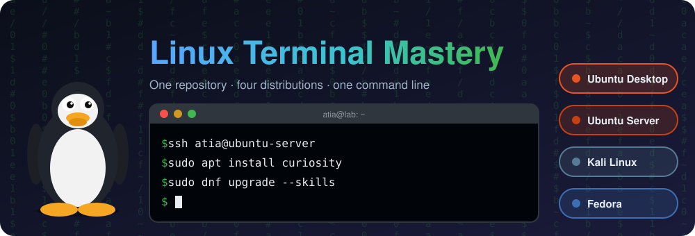
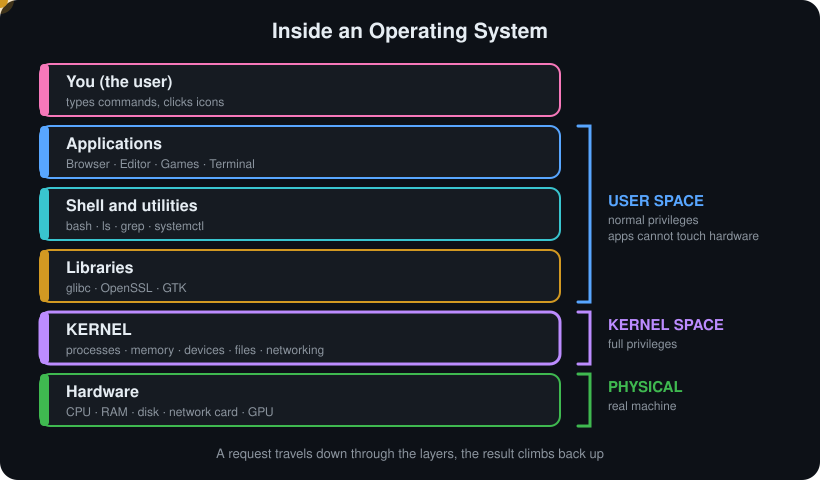
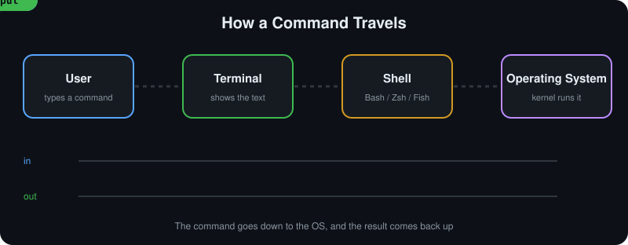
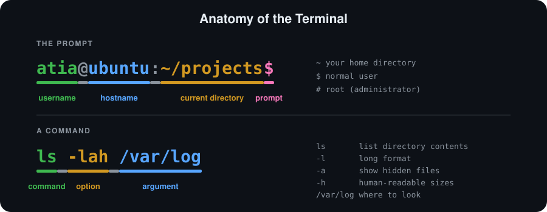
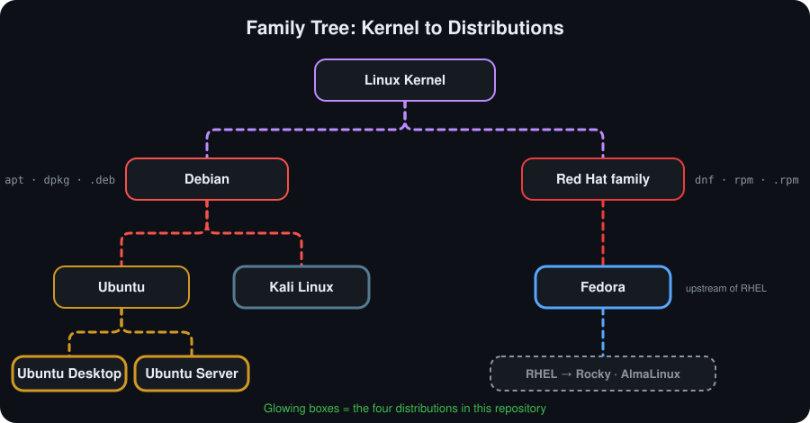
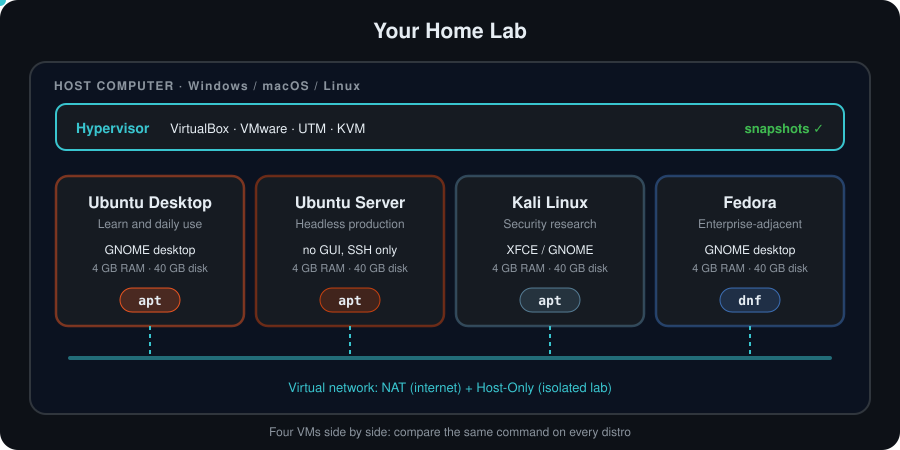
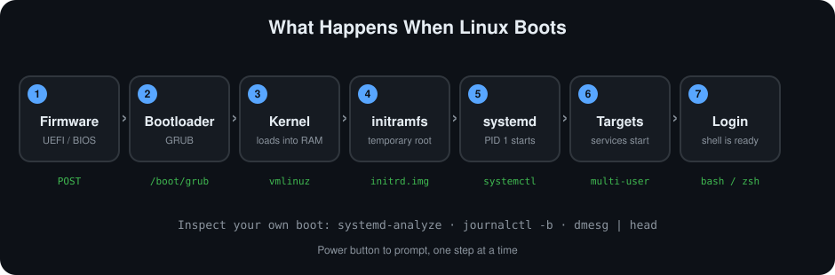
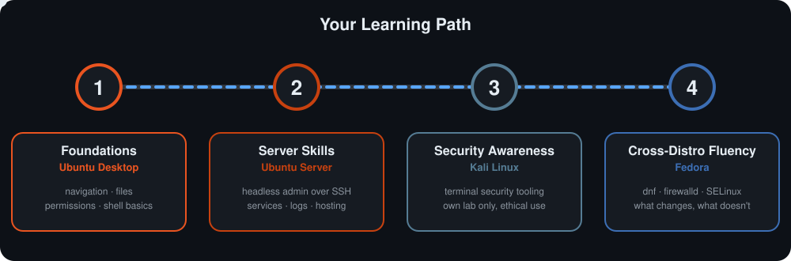

<p align="center">
  
</p>

<div align="center">

[](LICENSE)
[](#distributions-covered)
[](https://www.markdownguide.org/)
[](#)
[](https://www.linkedin.com/in/atia-sanjida-085947233/)

**Master the Linux command line across Ubuntu, Kali, and Fedora**

</div>

> A single, structured learning path for the Linux terminal, built once and applied across every major distribution family. Install each OS in a VM, then build the exact same command-line skills whether you're on a Debian-based desktop, a headless server, a penetration-testing distro, or a Red Hat–based system.

**Author:** [Atia Sanjida](https://www.linkedin.com/in/atia-sanjida-085947233/) · **Contact:** [atia.abk@gmail.com](mailto:atia.abk@gmail.com)

<p align="center">
  <a href="#-what-is-an-operating-system">🧠 OS Basics</a> ·
  <a href="#-a-short-history-of-unix-and-linux">📜 History</a> ·
  <a href="#-linux-vs-windows-vs-macos">⚔️ Linux vs Windows vs macOS</a> ·
  <a href="#-terminals-and-shells-compared">🐚 Terminals</a> ·
  <a href="#-setting-up-your-lab-vm-installation">💿 Lab Setup</a> ·
  <a href="#-learning-path">🗺️ Learning Path</a>
</p>

<!--
## 📖 Table of Contents

1. [Why This Repository Exists](#why-this-repository-exists)
2. [What Is an Operating System?](#what-is-an-operating-system)
3. [A Short History of Unix and Linux](#a-short-history-of-unix-and-linux)
4. [Linux vs Windows vs macOS](#linux-vs-windows-vs-macos)
5. [Terminals and Shells Compared](#terminals-and-shells-compared)
6. [Distributions Covered](#distributions-covered)
7. [Repository Structure](#repository-structure)
8. [Setting Up Your Lab (VM Installation)](#setting-up-your-lab-vm-installation)
9. [How the Distributions Differ](#how-the-distributions-differ)
10. [What Happens When Linux Boots](#what-happens-when-linux-boots)
11. [Terminal Fundamentals (Common to All)](#terminal-fundamentals-common-to-all)
12. [Package Managers — One Concept, Four Syntaxes](#package-managers-one-concept-four-syntaxes)
13. [Core Command Reference](#core-command-reference)
14. [Permissions, Users & Services](#permissions-users-services)
15. [Networking Basics](#networking-basics)
16. [Distro-Specific Guides](#distro-specific-guides)
17. [Learning Path](#learning-path)
18. [Cheat Sheets](#cheat-sheets)
19. [Glossary](#glossary)
20. [About the Author](#about-the-author)
21. [License](#license)

--->

<p align="center"></p>

## 🎯 Why This Repository Exists

Most Linux tutorials teach *one* distribution and leave you stuck when you meet another. In the real world, you'll move between:

- A **desktop distro** for daily use and learning
- A **server distro** with no GUI at all
- A **security-focused distro** for penetration testing
- A **Red Hat–family distro** used heavily in enterprise environments

The terminal (navigation, permissions, processes, networking, scripting) is **90% identical** across all of them. This repository teaches that shared core once, then documents the small but important differences (package managers, default tools, philosophy) per distribution.

<p align="center"></p>

## 🧠 What Is an Operating System?

An **operating system (OS)** is the software that sits between you, your programs, and the physical machine. It shares the CPU, memory, disk, and network among everything that wants to use them, and it keeps programs from trampling each other.

<p align="center">
  
</p>

### The kernel is the heart

The **kernel** is the one program that is allowed to talk to hardware directly. Everything else asks it for help through **system calls**.

| Kernel job | What it means | You can see it with |
|---|---|---|
| **Process management** | Starts, schedules, and stops programs | `ps aux`, `top` |
| **Memory management** | Hands out RAM and virtual memory | `free -h` |
| **Device management** | Talks to disks, keyboards, GPUs through drivers | `lsblk`, `lsusb` |
| **File systems** | Turns raw disk blocks into files and folders | `df -h`, `mount` |
| **Networking** | Sends and receives packets | `ip a`, `ss -tulpn` |
| **Security** | Enforces users, groups, and permissions | `id`, `ls -l` |

### Kernel space vs user space

| | Kernel space | User space |
|---|---|---|
| **Who runs there** | The kernel and its drivers | Your apps, shell, and tools |
| **Privileges** | Full access to hardware | Limited, must ask the kernel |
| **If it crashes** | The whole system can go down | Usually only that program dies |

### Try it yourself

```bash
uname -a                  # kernel name, version, architecture
cat /etc/os-release       # which distribution am I on?
hostnamectl               # host, OS, and kernel summary
```

```bash
# Linux only: watch a program ask the kernel to open a file (install strace first)
strace -e trace=openat cat /etc/hostname 2>&1 | tail -3
```

> [!NOTE]
> `uname -a` works on Linux and macOS. `/etc/os-release` and `hostnamectl` are Linux specific.

<p align="center"></p>

## 📜 A Short History of Unix and Linux

<p align="center">
  
</p>

| Year | Milestone | Why it matters |
|---|---|---|
| **1969** | **Unix** is created at Bell Labs | Introduced ideas still used today: everything is a file, small tools that do one job, pipes |
| **1983** | **GNU Project** starts (Richard Stallman) | Free replacements for Unix tools: the compiler, shell, `ls`, `grep`, and more |
| **1991** | **Linux kernel** released by Linus Torvalds | The missing piece: a free kernel to pair with the GNU tools |
| **1993** | **Debian** founded | The base for Ubuntu, Kali, and many others |
| **2003** | **Fedora** appears | Community distro sponsored by Red Hat, a testing ground for enterprise features |
| **2004** | **Ubuntu** first release | Made Linux friendly for ordinary desktops |
| **2008** | **Android** phones ship | Put the Linux kernel in billions of pockets |
| **2013** | **Kali Linux** replaces BackTrack | A distro built for security testing |

### Linux in one sentence

> **Linux is a kernel.** A **distribution** adds the GNU tools, a package manager, and (optionally) a desktop to turn that kernel into a complete operating system. That is why some people say "GNU/Linux".

### Where Linux runs today

- ☁️ **Cloud and servers:** the default choice for hosting
- 📱 **Phones:** Android is built on the Linux kernel
- 🚀 **Supercomputers:** every system on the TOP500 list has run Linux since late 2017
- 🔌 **Embedded devices:** routers, TVs, cars, smart-home hubs
- 🛡️ **Security work:** most penetration-testing tools target or run on Linux

### Why "open source" matters

Linux uses the **GNU General Public License (GPLv2)**. In practice that gives you four freedoms: **run** the software, **study** how it works, **share** copies, and **modify** it. You can read the code that runs your machine.

<p align="center"></p>

## ⚔️ Linux vs Windows vs macOS

<p align="center">
  
</p>

### Where things live

The same idea lives in a different place on each system.

| Thing | 🐧 Linux | 🍎 macOS | 🪟 Windows |
|---|---|---|---|
| Your files | `/home/atia` | `/Users/atia` | `C:\Users\atia` |
| Programs | `/usr/bin`, `/opt` | `/Applications`, `/opt/homebrew` | `C:\Program Files` |
| System settings | `/etc` (text files) | `/etc`, `/Library` | Registry, `C:\ProgramData` |
| Temporary files | `/tmp` | `/tmp` | `C:\Windows\Temp`, `%TEMP%` |
| Logs | `/var/log`, `journalctl` | `/var/log`, Console app | Event Viewer |
| Extra disks | mounted under `/mnt`, `/media` | `/Volumes/...` | `D:\`, `E:\` |
| Path separator | `/` | `/` | `\` |
| Environment variable | `$HOME` | `$HOME` | `%USERPROFILE%` or `$env:USERPROFILE` |
| Line endings in text files | LF | LF | CRLF |
| Run as administrator | `sudo` | `sudo` | UAC, "Run as administrator" |
| Task monitor | `top`, `htop` | Activity Monitor, `top` | Task Manager |

### Which one is best at what?

| | Strongest at | Typical audience |
|---|---|---|
| **Linux** | Servers, cloud, containers, embedded, security tooling, full control | Developers, sysadmins, security professionals, learners |
| **Windows** | Gaming, business software, broad hardware support | Office users, gamers, enterprises |
| **macOS** | Polished desktop on Apple hardware, UNIX tools out of the box | Designers, mobile developers, Apple users |

> [!TIP]
> **Already on Windows?** WSL2 runs a real Linux environment inside Windows (`wsl --install`). **On a Mac?** macOS is UNIX-certified, so most commands in this repo work in Terminal, but use an Ubuntu VM for Linux-only tools like `apt`, `systemctl`, and `ufw`.

<p align="center"></p>

## 🐚 Terminals and Shells Compared

These three words are often mixed up, but they are different things.

| Word | What it is | Examples |
|---|---|---|
| **Terminal** (emulator) | The window where you type and read text | GNOME Terminal, Konsole, iTerm2, Windows Terminal |
| **Shell** | The program that reads your command and runs it | Bash, Zsh, Fish, PowerShell |
| **Console / TTY** | The text interface built into the system, with no desktop needed | `Ctrl + Alt + F3` on many Linux desktops |

<p align="center">
  
</p>

### Shell showdown

<p align="center">
  
</p>

> [!IMPORTANT]
> Kali and macOS default to **Zsh**, while Ubuntu and Fedora default to **Bash**. The basics in this repo work the same in both.

### Terminal emulators

| Emulator | Platform | Known for |
|---|---|---|
| **GNOME Terminal / Console** | Linux (GNOME) | Simple and standard on GNOME desktops |
| **Konsole** | Linux (KDE) | Tabs, split view, heavy customisation |
| **xterm** | Linux / X11 | The classic, very lightweight |
| **Alacritty, kitty, WezTerm** | Cross-platform | GPU-accelerated, fast |
| **Terminal.app, iTerm2** | macOS | Built-in and feature-rich options |
| **Windows Terminal** | Windows | Tabs for PowerShell, CMD, and WSL |

### Same job, different command

| Task | Linux / macOS (Bash, Zsh) | PowerShell | CMD |
|---|---|---|---|
| Show current folder | `pwd` | `Get-Location` (alias `pwd`) | `cd` |
| List files | `ls` | `Get-ChildItem` (aliases `ls`, `dir`) | `dir` |
| Show a file | `cat file` | `Get-Content file` (alias `cat`) | `type file` |
| Copy | `cp a b` | `Copy-Item a b` (alias `cp`) | `copy a b` |
| Move / rename | `mv a b` | `Move-Item a b` (alias `mv`) | `move a b` |
| Delete a file | `rm file` | `Remove-Item file` (alias `rm`) | `del file` |
| Search text | `grep word file` | `Select-String word file` | `findstr word file` |
| Clear screen | `clear` | `Clear-Host` | `cls` |
| List processes | `ps aux` | `Get-Process` | `tasklist` |
| Stop a process | `kill PID` | `Stop-Process -Id PID` | `taskkill /PID PID` |
| Find a command | `which ls` | `Get-Command ls` | `where ls` |
| Network info | `ip a` | `Get-NetIPAddress` | `ipconfig` |
| Trace a route | `traceroute host` | `Test-NetConnection host -TraceRoute` | `tracert host` |
| Help | `man ls` | `Get-Help Get-ChildItem` | `help dir` |

### Text vs objects

Bash pipes **text** from one command to the next. PowerShell pipes **objects** with named properties.

```bash
# Bash: filter lines of text
ps aux | grep nginx
```

```powershell
# PowerShell: filter objects by property
Get-Process | Where-Object { $_.Name -eq "nginx" } | Select-Object Name, CPU
```

### Anatomy of a prompt and a command

<p align="center">
  
</p>

<p align="center"></p>

## 🖥️ Distributions Covered

| Distribution | Family | Primary Use Case | Package Manager |
|---|---|---|---|
| **Ubuntu Desktop** | Debian-based | Learning, daily-driver workstation | `apt` |
| **Ubuntu Server** | Debian-based | Headless servers, cloud, production | `apt` |
| **Kali Linux** | Debian-based | Penetration testing, security research | `apt` |
| **Fedora** | Red Hat–based | Cutting-edge desktop, RHEL-adjacent admin skills | `dnf` |

<p align="center">
  
</p>

### Debian family vs Red Hat family

| | Debian family (Ubuntu, Kali) | Red Hat family (Fedora) |
|---|---|---|
| Package format | `.deb` | `.rpm` |
| High-level tool | `apt` | `dnf` |
| Low-level tool | `dpkg` | `rpm` |
| Default firewall tool | `ufw` | `firewalld` |
| Default security framework | AppArmor (Ubuntu) | SELinux |
| Admin group | `sudo` | `wheel` |
| Philosophy | Stable, huge package archive | Fresh technology, upstream of enterprise Red Hat |

<!-- 
## 📁 Repository Structure

```
Linux-Terminal-Mastery/
├── README.md                     ← you are here (common guide + hub)
├── LICENSE
│
├── common/                       ← shared across ALL distros
│   ├── terminal-basics.md
│   ├── permissions.md
│   ├── package-managers.md
│   ├── networking.md
│   ├── shell-scripting.md
│   ├── troubleshooting.md
│   └── cheatsheets/
│       └── universal-commands.md
│
├── ubuntu-desktop/
│   └── README.md                 ← VM install guide + desktop-specific notes
│
├── ubuntu-server/
│   └── README.md                 ← VM install guide + server-specific notes
│
├── kali-linux/
│   └── README.md                 ← VM install guide + security-tooling notes
│
├── fedora/
│   └── README.md                 ← VM install guide + dnf/RHEL-family notes
│
└── images/                       ← screenshots, diagrams
```


> **How to use this repo:** Start here for anything common to all four distros (permissions, navigation, scripting, networking). Go into a distro's own folder only for installation steps and that distro's unique quirks.

<p align="center"></p>

## 💿 Setting Up Your Lab (VM Installation)

All four distributions in this repo are meant to be run as **virtual machines**: safe, disposable, and identical in behavior to real hardware for terminal practice.

<p align="center">
  
</p>

### 1. Choose a Hypervisor

| Hypervisor | Platform | Notes |
|---|---|---|
| **VirtualBox** | Windows / macOS / Linux | Free, beginner-friendly, most widely documented |
| **VMware Workstation Pro / Fusion Pro** | Windows, Linux / macOS | Free for personal use; the old Player editions were discontinued |
| **UTM** | macOS (Apple Silicon) | Best option on M1/M2/M3 Macs |
| **virt-manager (KVM)** | Linux host | Best performance if your host is already Linux |

> [!WARNING]
> **Apple Silicon Macs** need ARM64 images. Download the ARM64 (aarch64) version of each ISO, because x86 images will not boot there.

### 2. Download the ISOs

| Distro | Download |
|---|---|
| Ubuntu Desktop | https://ubuntu.com/download/desktop |
| Ubuntu Server | https://ubuntu.com/download/server |
| Kali Linux | https://www.kali.org/get-kali/ |
| Fedora Workstation | https://fedoraproject.org/workstation/download |

### 3. Recommended VM Specs (per machine)

| Resource | Minimum | Recommended |
|---|---|---|
| RAM | 2 GB | 4 GB |
| Disk | 20 GB | 40 GB |
| CPU | 2 cores | 2–4 cores |
| Network | NAT | NAT + Host-Only (for isolated lab practice) |

### 4. General VM Creation Steps (same for all four)

1. Open your hypervisor → **New Virtual Machine**.
2. Select the downloaded ISO as the boot media.
3. Allocate RAM/CPU/disk per the table above.
4. Boot the VM and run the OS installer (each distro's exact installer steps are in its own folder; see [Distro-Specific Guides](#distro-specific-guides)).
5. After install, take a **snapshot** immediately. This gives you a clean checkpoint to roll back to if you break something while practicing (which you should do, on purpose, often).
6. Install guest additions/tools for better performance:
   - VirtualBox: **Devices → Insert Guest Additions CD**
   - VMware: **VM → Install VMware Tools**

> 💡 **Tip:** Run all four VMs side by side (if your host has the RAM) so you can directly compare command output between distributions as you learn.

<p align="center"></p>

## 🔍 How the Distributions Differ

| Aspect | Ubuntu Desktop | Ubuntu Server | Kali Linux | Fedora |
|---|---|---|---|---|
| GUI by default | ✅ Yes (GNOME) | ❌ No | ✅ Yes (XFCE/GNOME) | ✅ Yes (GNOME) |
| Default user | Standard user + sudo | Standard user + sudo | `root`-oriented (modern Kali: standard user) | Standard user + sudo |
| Default shell | Bash | Bash | Zsh | Bash |
| Package manager | `apt` | `apt` | `apt` | `dnf` |
| Init system | systemd | systemd | systemd | systemd |
| Firewall tool | `ufw` | `ufw` | `ufw` (often disabled for testing) | `firewalld` |
| Update cycle | LTS every 2 years, plus interim releases | LTS every 2 years, plus interim releases | Rolling release | New release about every 6 months, each supported for about 13 months |
| Typical role | Learning, workstation | Production/cloud servers | Offensive security | Enterprise-adjacent desktop/dev |

> [!NOTE]
> Fedora is **not** a rolling release. It ships fixed versions on a regular schedule, which makes it "cutting-edge" but still predictable.

<p align="center"></p>

## 🔌 What Happens When Linux Boots

<p align="center">
  
</p>

| Stage | What it does |
|---|---|
| **Firmware (UEFI/BIOS)** | Tests the hardware (POST) and finds a bootable disk |
| **Bootloader (GRUB)** | Lets you choose an OS or kernel and loads the kernel |
| **Kernel** | Starts, detects hardware, mounts a temporary root |
| **initramfs** | A tiny starter filesystem with the drivers needed to reach the real disk |
| **systemd (PID 1)** | The first process; it starts everything else |
| **Targets** | Groups of services, like `multi-user.target` (text) or `graphical.target` (desktop) |
| **Login** | A login prompt or desktop appears and your shell starts |

### systemd in practice

systemd manages **units**: services, timers, mounts, and more. These commands are identical on all four distros.

```bash
systemctl status ssh              # is the service running?
sudo systemctl start ssh          # start it now
sudo systemctl enable --now ssh   # start now AND at every boot
journalctl -u ssh -f              # follow that service's logs
journalctl -b                     # everything since this boot
systemd-analyze                   # how long did boot take?
```

> [!WARNING]
> The SSH service is called **`ssh`** on Ubuntu and Kali, but **`sshd`** on Fedora. This kind of small naming difference is exactly what this repo helps you spot.

<p align="center"></p>

## ⚡ Terminal Fundamentals (Common to All)

These work **identically** on every distro in this repo. Full depth in [`common/terminal-basics.md`](common/terminal-basics.md).

| Category | Commands |
|---|---|
| Navigation | `pwd`, `cd`, `ls`, `tree` |
| File operations | `cp`, `mv`, `rm`, `mkdir`, `touch` |
| Viewing files | `cat`, `less`, `head`, `tail` |
| Searching | `grep`, `find`, `locate` |
| Permissions | `chmod`, `chown` |
| Processes | `ps`, `top`, `htop`, `kill` |
| Text processing | `sed`, `awk`, `cut`, `sort`, `uniq` |
| Compression | `tar`, `zip`, `gzip` |
| Networking | `ip`, `ping`, `ss`, `ssh`, `scp` |
| System info | `df`, `du`, `free`, `uptime`, `uname -a` |

### Power moves: pipes and redirection

Small tools become powerful when you connect them.

| Symbol | Meaning | Example |
|---|---|---|
| `\|` | Send output of one command into the next | `ls -l \| grep ".txt"` |
| `>` | Write output to a file (overwrites) | `echo "hi" > notes.txt` |
| `>>` | Append output to a file | `echo "more" >> notes.txt` |
| `<` | Read input from a file | `sort < names.txt` |
| `2>` | Send error messages to a file | `find / -name x 2> errors.txt` |
| `&&` | Run the next command only if the first succeeded | `mkdir demo && cd demo` |
| `;` | Run commands one after another | `date; whoami` |
| `$(...)` | Use a command's output inside another | `echo "Today is $(date)"` |

### Keyboard shortcuts that save hours

| Keys | What it does |
|---|---|
| `Tab` | Auto-complete commands and file names |
| `↑` / `↓` | Walk through command history |
| `Ctrl + R` | Search your command history |
| `Ctrl + C` | Stop the running command |
| `Ctrl + D` | Exit the shell (end of input) |
| `Ctrl + L` | Clear the screen |
| `Ctrl + A` / `Ctrl + E` | Jump to start / end of the line |
| `!!` | Repeat the last command (`sudo !!` adds sudo) |

<p align="center"></p>

## 📦 Package Managers — One Concept, Four Syntaxes

Same task, different command. This is usually the *only* thing that changes between distros day-to-day.

| Task | Ubuntu / Kali (`apt`) | Fedora (`dnf`) |
|---|---|---|
| Update package index | `sudo apt update` | `sudo dnf check-update` |
| Upgrade all packages | `sudo apt upgrade` | `sudo dnf upgrade` |
| Install a package | `sudo apt install nginx` | `sudo dnf install nginx` |
| Remove a package | `sudo apt remove nginx` | `sudo dnf remove nginx` |
| Search for a package | `apt search nginx` | `dnf search nginx` |
| List installed packages | `apt list --installed` | `dnf list installed` |
| Show package info | `apt show nginx` | `dnf info nginx` |

### Beyond this repo

| | Debian family | Red Hat family | Arch | macOS | Windows |
|---|---|---|---|---|---|
| Tool | `apt` | `dnf` | `pacman` | Homebrew (`brew`) | `winget` |
| Install | `sudo apt install pkg` | `sudo dnf install pkg` | `sudo pacman -S pkg` | `brew install pkg` | `winget install pkg` |
| Upgrade all | `sudo apt upgrade` | `sudo dnf upgrade` | `sudo pacman -Syu` | `brew upgrade` | `winget upgrade --all` |
| Remove | `sudo apt remove pkg` | `sudo dnf remove pkg` | `sudo pacman -R pkg` | `brew uninstall pkg` | `winget uninstall pkg` |

> [!TIP]
> A package manager is like an app store for the terminal: it finds software, installs its dependencies, and keeps everything updated in one command.

Full guide: [`common/package-managers.md`](common/package-managers.md)

<p align="center"></p>

## 📋 Core Command Reference

```bash
# Navigation
pwd                      # print working directory
cd /var/log               # change directory
ls -lah                   # list all files, long format

# Files
cp -r project/ backup/    # copy directory
mv old.txt new.txt        # rename/move
rm -r folder/             # remove directory
mkdir -p a/b/c             # create nested dirs

# Searching
grep -rn "ERROR" .          # search text recursively
find . -name "*.log"        # find files by name

# Permissions
chmod 750 script.sh          # set permissions
chown user:group file        # change ownership

# Processes
ps aux | grep nginx          # find a process
top                           # live resource monitor
kill -15 PID                  # graceful stop

# Networking
ip a                          # show interfaces
ssh user@host                  # remote login
```

<p align="center"></p>

## 🔐 Permissions, Users & Services

Fully identical concepts across all four distros (permission bits, `useradd`, `systemctl`). Full breakdown in [`common/permissions.md`](common/permissions.md). The differences are the **firewall tool** (`ufw` on the Debian-family distros vs `firewalld` on Fedora) and the **admin group** name.

<p align="center">
  
</p>

### Common permission modes

| Mode | Symbolic | Typical use |
|---|---|---|
| `644` | `rw-r--r--` | Normal files: owner edits, everyone reads |
| `755` | `rwxr-xr-x` | Programs and folders: everyone can run or enter |
| `600` | `rw-------` | Private files like SSH keys |
| `700` | `rwx------` | Private folders |
| `750` | `rwxr-x---` | Owner full, group read and run, others nothing |
| `777` | `rwxrwxrwx` | ⚠️ Everyone can do everything. Avoid |

### Users and groups

```bash
id                              # who am I, which groups?
sudo useradd -m -s /bin/bash bob   # create a user with a home folder
sudo passwd bob                 # set a password
sudo usermod -aG sudo bob       # Ubuntu / Kali: give admin rights
sudo usermod -aG wheel bob      # Fedora: the admin group is "wheel"
```

### Firewall and security framework

| Task | Ubuntu / Kali | Fedora |
|---|---|---|
| Allow SSH | `sudo ufw allow 22/tcp` | `sudo firewall-cmd --permanent --add-service=ssh` |
| Apply / enable | `sudo ufw enable` | `sudo firewall-cmd --reload` |
| Check status | `sudo ufw status` | `sudo firewall-cmd --list-all` |
| Mandatory access control | AppArmor (`sudo aa-status`) | SELinux (`getenforce`) |

<p align="center"></p>

## 🌐 Networking Basics

Covered in depth, distro-agnostic, in [`common/networking.md`](common/networking.md): `ip`, `ping`, `ss`, `ssh`, `scp`, `rsync`, and reading `/etc/resolv.conf`.

| Task | Linux | Windows equivalent |
|---|---|---|
| Show IP addresses | `ip a` | `ipconfig` |
| Show routes | `ip route` | `route print` |
| Test connectivity | `ping host` | `ping host` |
| Open ports and listeners | `ss -tulpn` | `netstat -ano` |
| Fetch a web page | `curl https://example.com` | `curl` or `Invoke-WebRequest` |
| DNS lookup | `dig example.com` | `nslookup example.com` |
| Remote login | `ssh user@host` | `ssh user@host` |
| Copy over SSH | `scp file user@host:/path` | `scp file user@host:/path` |

### Ports worth memorising

| Port | Service |
|---|---|
| 22 | SSH |
| 53 | DNS |
| 80 | HTTP |
| 443 | HTTPS |

<p align="center"></p>

## 🗂️ Distro-Specific Guides

Each folder below contains a **VM installation walkthrough** plus what's unique to that distribution:

| Folder | Contents |
|---|---|
| [`ubuntu-desktop/`](ubuntu-desktop/README.md) | VM install steps, GUI vs terminal workflow, everyday-use tips |
| [`ubuntu-server/`](ubuntu-server/README.md) | Headless VM install, SSH-only access, service hosting basics |
| [`kali-linux/`](kali-linux/README.md) | VM install, security tooling overview, safe/legal-use notice |
| [`fedora/`](fedora/README.md) | VM install steps, `dnf`/`firewalld` specifics, SELinux basics |

## 🗺️ Learning Path

<p align="center">
  
</p>

| Stage | Focus |
|---|---|
| **1. Foundations** | Install Ubuntu Desktop in a VM → master navigation, files, permissions |
| **2. Server Skills** | Install Ubuntu Server → practice headless administration over SSH |
| **3. Security Awareness** | Install Kali Linux → explore terminal-based security tooling (ethically, on your own lab only) |
| **4. Cross-Distro Fluency** | Install Fedora → notice what changes (`dnf`, `firewalld`, SELinux) and what doesn't |

> [!CAUTION]
> Only practise security tools on machines you own or have **written permission** to test. Keep Kali on an isolated Host-Only network.

## 📑 Cheat Sheets

See [`common/cheatsheets/universal-commands.md`](common/cheatsheets/universal-commands.md) for a printable one-pager that works on all four distributions.

## 📚 Glossary

| Term | Plain-English meaning |
|---|---|
| **Kernel** | The core of the OS that controls hardware and shares resources |
| **Distribution (distro)** | A complete OS built from the Linux kernel plus tools, a package manager, and often a desktop |
| **Shell** | The program that reads and runs the commands you type |
| **Terminal** | The window that shows the shell |
| **Package** | Software bundled with its metadata and dependencies |
| **Repository** | An online library of packages your package manager downloads from |
| **Daemon / service** | A program that runs in the background |
| **Root** | The administrator account with unlimited power |
| **`sudo`** | Run one command with administrator rights |
| **`PATH`** | The list of folders the shell searches for commands |
| **Environment variable** | A named setting such as `$HOME` or `$PATH` |
| **Mount** | Attaching a disk or filesystem to a folder so you can use it |
| **Hypervisor** | Software that runs virtual machines |
| **Snapshot** | A saved checkpoint of a VM you can roll back to |
| **ISO** | A disk image used to install an operating system |

<p align="center"></p>

## ✍️ About the Author

| | |
|---|---|
| **Name** | Atia Sanjida |
| **Email** | [atia.abk@gmail.com](mailto:atia.abk@gmail.com) |
| **LinkedIn** | [linkedin.com/in/atia-sanjida](https://www.linkedin.com/in/atia-sanjida-085947233/) |
| **GitHub** | [github.com/AtiaAbk](https://github.com/AtiaAbk) |

This repository is part of an ongoing cybersecurity and systems engineering portfolio. Feedback, corrections, and collaboration inquiries are welcome via any of the channels above.

## 📄 License

This project is licensed under the [MIT License](LICENSE) — © 2026 Atia Sanjida.

---

<p align="center">
  <sub>Built and maintained by <a href="https://www.linkedin.com/in/atia-sanjida-085947233/">Atia Sanjida</a> — if this repository helped you, consider starring it ⭐</sub>
</p>
