<p align="center">
  
</p>

<p align="center">
  
  
  
  
  
</p>

<p align="center">
  <a href="#contents">📚 Contents</a> &nbsp;•&nbsp;
  <a href="#3-the-root-directory--complete-directory-map">🗺️ Root map</a> &nbsp;•&nbsp;
  <a href="#10-permissions-ownership-acls-and-special-bits">🔐 Permissions</a> &nbsp;•&nbsp;
  <a href="#13-boot-process-and-the-files-it-touches">🚀 Boot</a> &nbsp;•&nbsp;
  <a href="#19-troubleshooting-scenarios">🛠️ Troubleshooting</a> &nbsp;•&nbsp;
  <a href="#20-interview-questions-and-model-answers">🎯 Interview</a> &nbsp;•&nbsp;
  <a href="#21-quick-revision-cheat-sheet">📝 Cheat sheet</a>
</p>

<p align="center">
  
</p>

> [!NOTE]
> **Scope:** Multi-user Linux systems, the Filesystem Hierarchy Standard (FHS), directory and file roles, boot and service configuration, users and permissions, storage/mounts, virtual filesystems, practical commands, realistic examples, troubleshooting, and interview preparation.

> [!IMPORTANT]
> **Important:** Linux distributions differ. This guide describes the common layout used by mainstream Linux distributions (Ubuntu/Debian, Fedora/RHEL-family, Arch, SUSE). A file may be absent, generated at boot, provided by a package, or placed elsewhere by a distribution. Always verify the actual machine with `man`, `findmnt`, `ls`, and package documentation.

## Contents

| | Chapter | What you'll learn |
|:-:|---|---|
| 🧠 | **[The mental model](#1-the-mental-model)** | One tree, mounts, paths and the VFS in action |
| 🏗️ | **[Filesystem architecture: layers and flow](#2-filesystem-architecture-layers-and-flow)** | Layers, namespace vs storage, directory finder |
| 🗺️ | **[The root directory `/`: complete directory map](#3-the-root-directory--complete-directory-map)** | Every top-level directory at a glance |
| 📂 | **[Directory-by-directory deep dive](#4-directory-by-directory-deep-dive)** | Purpose, contents and gotchas of each directory |
| ⚙️ | **[The `/etc` configuration tree](#5-the-etc-configuration-tree)** | passwd, shadow, group, fstab, ssh and drop-ins |
| 📈 | **[The `/var` variable-data tree](#6-the-var-variable-data-tree)** | Logs, persistent state, caches, spool |
| 📦 | **[The `/usr` software tree](#7-the-usr-software-tree)** | bin, lib, share, local, src |
| 🏠 | **[The `/home` and `/root` user-data trees](#8-the-home-and-root-user-data-trees)** | Dotfiles, XDG directories, `~/.ssh` |
| 👥 | **[Multi-user architecture: users, groups, identity and login](#9-multi-user-architecture-users-groups-identity-and-login)** | UID/GID, NSS, PAM and the login path |
| 🔐 | **[Permissions, ownership, ACLs and special bits](#10-permissions-ownership-acls-and-special-bits)** | rwx, octal, setuid/setgid/sticky, umask, ACLs |
| 💽 | **[Filesystems, partitions, devices and mounts](#11-filesystems-partitions-devices-and-mounts)** | Partitions, filesystems, fstab vs mount |
| 👻 | **[Virtual and pseudo filesystems](#12-virtual-and-pseudo-filesystems)** | `/proc`, `/sys`, `/dev`, `/run`, tmpfs |
| 🚀 | **[Boot process and the files it touches](#13-boot-process-and-the-files-it-touches)** | UEFI → bootloader → kernel → systemd |
| 🔄 | **[Processes, services, sockets and runtime files](#14-processes-services-sockets-and-runtime-files)** | PIDs, systemd units, sockets |
| 📥 | **[Package management and where installed files go](#15-package-management-and-where-installed-files-go)** | APT, DNF, pacman — where files land |
| 🔗 | **[File types, links, inodes and paths](#16-file-types-links-inodes-and-paths)** | File types, inodes, hard vs symbolic links |
| ⌨️ | **[Practical command reference](#17-practical-command-reference)** | Everyday inspection commands |
| 🧪 | **[Hands-on lab: inspect a real Linux machine safely](#18-hands-on-lab-inspect-a-real-linux-machine-safely)** | 8 safe, read-only labs |
| 🛠️ | **[Troubleshooting scenarios](#19-troubleshooting-scenarios)** | 6 real-world failure scenarios |
| 🎯 | **[Interview questions and model answers](#20-interview-questions-and-model-answers)** | 50 model answers — click to expand |
| 📝 | **[Quick-revision cheat sheet](#21-quick-revision-cheat-sheet)** | One-page revision table + mnemonic |
| 📖 | **[Glossary](#22-glossary)** | Key terms defined |
| 📚 | **[Standards and authoritative references](#23-standards-and-authoritative-references)** | Standards, man pages and specifications |

### 🧭 Suggested learning path

| Level | Chapters | Goal |
|---|:-:|---|
| 🌱 **Beginner** | 1 – 4, 8 | Know the tree and what lives where |
| 🔧 **Administrator** | 5 – 7, 9 – 12 | Configure, secure and mount |
| 🚀 **Advanced** | 13 – 16 | Boot, services, packages, inodes |
| 🧪 **Practice** | 17 – 19 | Commands, labs, troubleshooting |
| 🎯 **Interview-ready** | 20 – 23 | Q&A, cheat sheet, glossary, references |

### 🎨 Colour legend used in the diagrams

| | | | | |
|:-:|:-:|:-:|:-:|:-:|
| 🟡 Config | 🟢 User data | 🔵 Software | 🟠 Variable | 🔴 Boot |
| 🟣 Virtual | 🩵 Devices | 🟩 Mounts | 🩷 Runtime | |

<p align="center">
  
</p>


# 1. The mental model

Linux presents one unified directory tree. It does **not** normally show each disk as a separate drive letter such as `C:` or `D:`. Every accessible filesystem is attached somewhere under the single root directory `/` by a **mount**.

Think of the filesystem as a tree:

<p align="center">
  
</p>

<details>
<summary>📄 Text version of this diagram</summary>

```text
                         /
              (root of the entire namespace)
                         |
       +---------+-------+--------+---------+
       |         |       |        |         |
      /etc      /home   /usr     /var      /boot
   config     user data software changing  boot files
                                  data
```

</details>

Key ideas:

- `/` is the top of the directory tree. It is not the same thing as `/root`.
- A **directory** maps names to filesystem objects; it is not merely a Windows-style folder concept.
- A **file** is a broad Unix concept. Regular files, directories, devices, sockets, pipes and symbolic links are all filesystem objects.
- The kernel provides the Virtual Filesystem Switch (VFS), which gives applications a common interface to different filesystem implementations.
- The same path can cross filesystem boundaries. For example, `/home` may be a separate disk or network filesystem mounted beneath `/`.
- Linux is multi-user: files have owners and groups, and access is checked through permission bits, ACLs and other security mechanisms.
- Not every visible path contains persistent disk data. `/proc`, `/sys`, `/dev` and often `/run` expose kernel, device or runtime information.

## 1.1 Path basics

| Path | Meaning |
|---|---|
| `/` | Root of the entire filesystem namespace |
| `/home/atia` | Absolute path: starts at `/` |
| `notes.txt` | Relative path: interpreted from current working directory |
| `.` | Current directory |
| `..` | Parent directory |
| `~` | Shell expansion for the current user's home directory |
| `~root` | Shell expansion for root's home directory, commonly `/root` |
| `/etc/hosts` | A specific absolute path |

A path is case-sensitive: `/etc/Hosts` and `/etc/hosts` are different names.

## 1.2 What happens when a program opens a file?

<p align="center">
  
</p>

<details>
<summary>📄 Text version of this diagram</summary>

```text
Application
    |
    | open("/etc/hosts", ...)
    v
System call interface
    |
    v
Linux VFS (Virtual Filesystem Switch)
    |
    +--> pathname lookup / directory entries
    |
    +--> permission and security checks
    |
    +--> inode / file operations
    |
    v
Filesystem driver (ext4, XFS, Btrfs, NFS, ...)
    |
    v
Block layer / device driver (if block storage is involved)
    |
    v
Storage device
```

</details>

This is a conceptual path. Caches, network filesystems, memory-backed filesystems, security modules and hardware details can change the exact route.

<p align="center">
  
</p>


# 2. Filesystem architecture: layers and flow

## 2.1 Four useful layers

1. **Namespace layer:** directories and paths such as `/etc/ssh/sshd_config`.
2. **VFS layer:** common kernel interfaces for lookup, open, read, write, permissions and filesystem operations.
3. **Filesystem implementation:** ext4, XFS, Btrfs, FAT, NFS, tmpfs and others.
4. **Storage or backing layer:** disk partitions, logical volumes, SSDs, network servers, RAM or device interfaces.

## 2.2 Directory hierarchy versus disk layout

These are different concepts:

<p align="center">
  
</p>

<details>
<summary>📄 Text version of this diagram</summary>

```text
Directory namespace                     Physical / logical storage

/                                      SSD partition / logical volume
├── etc                                ├── /
├── home  ---------------------------> ├── separate /home filesystem
├── var   ---------------------------> ├── separate /var filesystem (optional)
├── boot  ---------------------------> └── EFI System Partition mounted at /boot/efi
└── mnt
    └── backup ----------------------> external disk mounted here
```

</details>

A directory can be a mount point. A mount point is an ordinary directory before another filesystem is mounted on it. Once mounted, the mounted filesystem's root is visible there and the underlying directory contents are hidden until unmounted.

## 2.3 Visual map: where a request or piece of data usually travels

This map is a study aid, not a claim that every service uses exactly these paths.

<p align="center">
  
</p>

<details>
<summary>📄 Text version of this diagram</summary>

```text
                         LINUX HOST
                             |
                    one namespace: /
                             |
       +---------------------+----------------------+
       |                     |                      |
   ADMIN CONFIG          USER / APP             KERNEL / DEVICE
       |                     |                      |
     /etc                 /home                    /proc
       |                  /root                    /sys
       |                     |                      /dev
       |                     |
   service reads         user runs app
   configuration             |
       |                 /usr/bin/app
       |                     |
       +----------+----------+
                  |
             service runs
                  |
       +----------+--------------------+
       |                               |
   persistent state                live runtime
     /var/lib                        /run
       |                               |
   logs / queues                  sockets / pid state
   /var/log, /var/spool
```

</details>

### Directory decision tree

<p align="center">
  
</p>

<details>
<summary>📄 Text version of this diagram</summary>

```text
What kind of item are you looking for?
|
+-- System configuration? ----------------------> /etc
+-- A normal user's personal files? ------------> /home/USER
+-- Root administrator's personal files? ------> /root
+-- Installed command or library? --------------> /usr (or merged /bin, /lib)
+-- Locally installed administrator software? -> /usr/local
+-- Bootloader, kernel, initramfs? -------------> /boot (plus EFI mount)
+-- Device node? -------------------------------> /dev
+-- Process or kernel information? -------------> /proc
+-- Device model / kernel attributes? ----------> /sys
+-- Runtime socket or transient state? ---------> /run
+-- Logs? ---------------------------------------> /var/log or journal
+-- Service database/state? --------------------> /var/lib
+-- Downloaded/re-creatable cache? --------------> /var/cache
+-- Queued jobs? -------------------------------> /var/spool
+-- Temporary scratch file? -------------------> /tmp or /var/tmp
+-- Removable disk mount? ----------------------> /media
+-- Manual temporary mount? -------------------> /mnt
+-- Optional vendor application? ---------------> /opt
+-- Data offered by a service? -----------------> /srv (intended convention)
```

</details>

### Persistent versus volatile versus virtual

| Category | Typical paths | Survives reboot? | What it means |
|---|---|---|---|
| Persistent configuration | `/etc` | Usually yes | Admin-controlled settings |
| Persistent user data | `/home`, `/root` | Usually yes | User documents and preferences |
| Software | `/usr`, `/opt`, `/usr/local` | Usually yes | Installed programs and resources |
| Persistent variable state | `/var/lib`, `/var/log` | Usually yes, policy-dependent | Service state and logs |
| Volatile runtime | `/run` | No; recreated each boot | Live service/session state |
| Temporary | `/tmp` | Not guaranteed | Scratch data |
| Virtual kernel interfaces | `/proc`, `/sys` | Not disk-persistent | Live kernel/process/device view |
| Device interfaces | `/dev` | Entries recreated/managed | Access to devices |

## 2.4 FHS: the standard map

The Filesystem Hierarchy Standard (FHS) documents the purpose of common directories. Modern distributions follow it with variations. Learn the **purpose** of each directory rather than memorizing every package-specific file.

<p align="center">
  
</p>


# 3. The root directory `/`: complete directory map

A typical Linux root:

<p align="center">
  
</p>

<details>
<summary>📄 Text version of this diagram</summary>

```text
/
├── bin       Essential user command binaries (often symlink to /usr/bin)
├── boot      Bootloader files, kernels, initramfs
├── dev       Device nodes and device interfaces
├── etc       Host-specific system configuration
├── home      Ordinary users' home directories
├── lib       Essential shared libraries (often symlink to /usr/lib)
├── lib32     Optional 32-bit compatibility libraries
├── lib64     Optional 64-bit library path on some architectures
├── libx32    Optional x32 ABI libraries on some architectures
├── media     Automatic/removable media mount points
├── mnt       Temporary/manual mount points
├── opt       Optional add-on application software
├── proc      Process and kernel information (procfs)
├── root      Root user's home directory
├── run       Volatile runtime state since boot (often tmpfs)
├── sbin      Essential system administration binaries (often symlink to /usr/sbin)
├── srv       Data served by system services
├── sys       Kernel/device information and control (sysfs)
├── tmp       Temporary files; cleanup policy varies
├── usr       Most user-space programs, libraries and shared read-only data
└── var       Variable data: logs, caches, spool, databases, state
```

</details>

Additional paths you may see:

- `/lost+found`: recovery directory created by some filesystems such as ext-family filesystems.
- `/snap`: Snap package mount points/data on systems using Snap.
- `/var/lib/flatpak`: Flatpak system-wide application data on systems using Flatpak.
- `/nix`: Nix store on Nix-based systems.
- `/boot/efi` or `/efi`: EFI System Partition mount point, depending on distribution.
- `/usr/local`: locally installed software, usually managed by the administrator rather than the distribution package manager.

> [!IMPORTANT]
> **Important distinction:** On many modern distributions `/bin`, `/sbin`, `/lib` and `/lib64` are symbolic links into `/usr`. This is the “merged-/usr” layout. Do not assume they are always independent directories.

<p align="center">
  
</p>


# 4. Directory-by-directory deep dive

## 4.1 `/bin` — essential user commands

**Purpose:** Essential commands needed for basic system operation and recovery. On merged-/usr systems, `/bin` is commonly a symlink to `/usr/bin`.

Typical commands include:

```text
/bin/
├── sh
├── ls
├── cp
├── mv
├── rm
├── cat
├── mkdir
├── mount
└── (distribution-dependent commands)
```

Examples:
- `ls` lists directory entries.
- `cp` copies files.
- `mv` moves or renames paths.
- `rm` removes directory entries.
- `sh` is a POSIX-style shell interface, often linked to a shell implementation.

Do not expect this exact list on every distribution.

## 4.2 `/sbin` — essential system administration commands

**Purpose:** Historically, essential system binaries used mainly by the administrator. Commonly a symlink to `/usr/sbin` on merged-/usr systems.

Examples may include:
- `fsck`: filesystem consistency-check front end.
- `reboot`, `shutdown`: system power-state commands.
- `ip`: network configuration utility (often in `/usr/sbin` or `/usr/bin`).
- `mkfs.*`: filesystem creation tools (locations vary).

> [!NOTE]
> Modern Linux does not enforce a strict “only root can execute `/sbin`” rule. Permissions and capabilities control access.

## 4.3 `/boot` — boot files

Typical contents:

```text
/boot/
├── vmlinuz-<kernel-version>       Compressed Linux kernel image
├── initrd.img-<version>           Name used by some distributions for initramfs
├── initramfs-<version>.img        Name used by other distributions
├── config-<version>               Kernel build configuration (if installed)
├── System.map-<version>           Kernel symbol map (if installed)
└── grub/                          GRUB configuration/modules (if GRUB is used)
    ├── grub.cfg                   Generated boot menu configuration
    └── ...
```

What matters:
- The **kernel** is the core of the operating system.
- The **initramfs/initrd** is an early userspace environment used during boot to load required drivers and locate/mount the real root filesystem.
- A bootloader such as GRUB or systemd-boot loads the kernel and initramfs.
- `/boot/efi` commonly contains EFI bootloader files when the EFI System Partition is mounted there.
- Kernel and initramfs filenames and bootloader layout differ by distribution.

> [!WARNING]
> Never casually edit generated `grub.cfg`; use the distribution's documented configuration workflow.

## 4.4 `/dev` — device interfaces

`/dev` contains device nodes and dynamically managed device entries. Many are created/managed by `udev` and devtmpfs.

Examples:

| Path | Meaning |
|---|---|
| `/dev/null` | Discards data written to it; reads return EOF |
| `/dev/zero` | Supplies zero bytes when read |
| `/dev/random` | Random-number interface |
| `/dev/urandom` | Random-number interface |
| `/dev/tty` | Controlling terminal of the current process |
| `/dev/pts/0` | Example pseudo-terminal slave |
| `/dev/sda` | Example SATA/SCSI-style disk name; not universal |
| `/dev/nvme0n1` | Example NVMe namespace |
| `/dev/loop0` | Loop device |
| `/dev/mapper/` | Device-mapper devices, often LVM or encryption |

Device naming depends on drivers and hardware. A device node is not necessarily a normal file containing the device's data.

## 4.5 `/etc` — system-wide configuration

**Purpose:** Host-specific configuration. Usually text files and subdirectories, not program binaries.

Examples:
- `/etc/passwd`: account identity records.
- `/etc/shadow`: password hashes and password-aging data, normally restricted.
- `/etc/group`: group records.
- `/etc/fstab`: filesystems intended for mounting.
- `/etc/hosts`: static hostname-to-address mappings.
- `/etc/hostname`: system hostname on many distributions.
- `/etc/ssh/sshd_config`: OpenSSH server configuration.
- `/etc/sudoers`: sudo policy; edit with `visudo`.
- `/etc/cron.d/`: system cron job definitions on cron implementations that support it.
- `/etc/systemd/`: systemd unit/configuration directories.
- `/etc/apt/`: APT configuration on Debian/Ubuntu.
- `/etc/dnf/` or `/etc/yum.repos.d/`: DNF/YUM configuration and repositories on relevant systems.

See the detailed tree in [Section 5](#5-the-etc-configuration-tree).

## 4.6 `/home` — ordinary users' personal data

Typical layout:

```text
/home/
├── atia/
│   ├── Desktop/
│   ├── Documents/
│   ├── Downloads/
│   ├── Music/
│   ├── Pictures/
│   ├── Videos/
│   ├── Public/
│   ├── .bashrc
│   ├── .profile
│   ├── .ssh/
│   │   ├── config
│   │   ├── authorized_keys
│   │   └── known_hosts
│   └── .config/
└── another_user/
```

The subdirectories are conventions, not mandatory kernel requirements. Hidden names begin with `.` and are omitted by plain `ls`; use `ls -la` to show them.

User home directories should normally be owned by their users, with access controlled by permissions/ACLs. On servers, `/home` may be a separate filesystem or network-mounted.

## 4.7 `/root` — root account's home

`/root` is the home directory of the superuser account named `root`. It is **not** the filesystem root `/`.

It may contain:
- `/root/.ssh/`: root's SSH client configuration and authorized keys.
- `/root/.bashrc`, `/root/.profile`: root's shell startup configuration.
- Administrative scripts and files.

Access should be restricted. Avoid using root for routine work; use a normal account and carefully controlled `sudo`.

## 4.8 `/lib`, `/lib64`, `/lib32` — essential libraries and modules

These paths historically hold essential shared libraries needed by binaries under `/bin` and `/sbin`, plus kernel modules under `/lib/modules`.

Common examples:

```text
/lib/
├── modules/
│   └── <kernel-version>/
│       ├── kernel/
│       ├── modules.dep
│       └── modules.alias
├── firmware/                 (may instead be under /usr/lib/firmware)
└── <dynamic-loader-and-libraries, layout varies>
```

- Shared libraries commonly end in `.so` (for example `libc.so.6`).
- The dynamic linker/loader loads shared libraries when a dynamically linked program starts.
- Kernel modules are loadable kernel components, commonly found under `/lib/modules/<kernel-version>/`.
- `ldconfig` maintains the shared-library cache on systems that use it.

On merged-/usr systems these directories may be symlinks to `/usr/lib` or architecture-specific locations.

## 4.9 `/media` — removable media mount points

Commonly used for automatically mounted removable devices, such as USB drives and optical media.

Example:

```text
/media/atia/USB_DRIVE/
```

The exact naming and automount behavior depend on desktop environment and system configuration.

## 4.10 `/mnt` — temporary/manual mount point

A conventional place for an administrator to mount a filesystem temporarily.

Example:

```bash
sudo mkdir -p /mnt/backup
sudo mount /dev/sdb1 /mnt/backup
findmnt /mnt/backup
sudo umount /mnt/backup
```

> [!WARNING]
> The example device `/dev/sdb1` is illustrative only. Identify the real device first; mounting the wrong partition can expose or alter the wrong data.

## 4.11 `/opt` — add-on application software

Used for optional/add-on application packages, often self-contained vendor software.

Example:

```text
/opt/
└── vendor-app/
    ├── bin/
    ├── lib/
    ├── share/
    └── README
```

Not every third-party installer uses `/opt`; some use `/usr/local`, `/usr`, or a user-local directory.

## 4.12 `/proc` — process and kernel information (procfs)

`/proc` is a virtual filesystem, usually mounted by the kernel. It exposes process and kernel information; most entries are not ordinary disk files.

Examples:

| Path | Meaning |
|---|---|
| `/proc/cpuinfo` | CPU information exposed by the kernel |
| `/proc/meminfo` | Memory statistics |
| `/proc/uptime` | Uptime and idle time |
| `/proc/mounts` | Current mount information |
| `/proc/cmdline` | Kernel command line |
| `/proc/1/` | Information for process ID 1 |
| `/proc/<PID>/status` | Process status details |
| `/proc/<PID>/fd/` | Process file-descriptor links |
| `/proc/sys/` | Kernel tunables exposed through procfs |

Some `/proc/sys` values can be changed at runtime. Changes can affect the running kernel and should be made only with a clear understanding of the setting.

## 4.13 `/run` — volatile runtime state

Usually a tmpfs created early during boot. Stores data needed by running services since the current boot.

Examples:
- `/run/lock/`: lock files.
- `/run/user/<UID>/`: per-user runtime directory, often managed by `systemd-logind`.
- `/run/systemd/`: systemd runtime state.
- `/run/sshd/`: runtime state for OpenSSH server on some distributions.
- `/run/<service>/`: service-specific sockets, PID files or state.

Do not treat `/run` as permanent storage. It is normally cleared at reboot.

## 4.14 `/srv` — data served by services

Intended for site-specific data served by the system, such as content for a web or file server.

Example:

```text
/srv/
├── www/
│   └── example-site/
└── ftp/
```

Actual web roots often live elsewhere, such as `/var/www`, `/usr/share/nginx/html`, or a custom path.

## 4.15 `/sys` — sysfs: kernel objects and devices

A virtual filesystem exposing kernel device model information and controls.

Examples:
- `/sys/class/net/`: network interfaces.
- `/sys/block/`: block devices.
- `/sys/devices/`: device hierarchy.
- `/sys/bus/`: device buses.
- `/sys/class/power_supply/`: power supply/battery interfaces where supported.

Use tools such as `ip`, `lsblk`, `udevadm` and `lspci` for normal administration. Writing directly to sysfs can change device/kernel behavior.

## 4.16 `/tmp` — temporary files

Temporary files used by programs and users. Cleanup policy varies: files may be deleted at reboot, by age-based cleanup, or by other policy.

Examples:
- Temporary editor files.
- Installer scratch files.
- Application temporary data.

Do not store the only copy of important data in `/tmp`. Permissions often include the sticky bit (`1777`) so users cannot remove one another's files even though the directory is writable by all.

## 4.17 `/usr` — user-space software and shared resources

`/usr` is one of the largest and most important trees. It commonly contains most installed user-space programs, libraries, documentation and architecture-independent data.

```text
/usr/
├── bin/       Most user commands and applications
├── sbin/      System administration commands
├── lib/       Libraries, modules and support files
├── lib64/     Architecture-specific library path on some systems
├── include/   C/C++ headers and development interfaces
├── share/     Architecture-independent data, docs, locales, icons
├── local/     Locally installed software and data
└── src/       Source code, often kernel source if installed
```

See [Section 7](#7-the-usr-software-tree).

## 4.18 `/var` — variable data

Data expected to change while the system runs: logs, caches, spool queues, databases, package state and service state.

```text
/var/
├── cache/     Re-creatable cached data
├── lib/       Persistent application/service state
├── local/     Variable data for /usr/local
├── lock/      Legacy lock path; often linked to /run/lock
├── log/       System and application logs
├── mail/      User mailboxes (implementation-dependent)
├── opt/       Variable data for /opt software
├── run/       Legacy path, commonly linked to /run
├── spool/     Queued work: print, mail, cron, etc.
└── tmp/       Temporary files preserved across some reboots
```

See [Section 6](#6-the-var-variable-data-tree).

<p align="center">
  
</p>


# 5. The `/etc` configuration tree

`/etc` is the directory an administrator should understand especially well. It contains system-wide configuration, but the exact files installed depend on packages and distribution.

## 5.1 High-value `/etc` files

| File/directory | What it stores | Why it matters |
|---|---|---|
| `/etc/passwd` | User account records: name, UID, GID, GECOS, home, shell | Identity lookup |
| `/etc/shadow` | Password hashes and aging fields | Authentication data; restricted |
| `/etc/group` | Group names, GIDs and supplementary member list | Group identity |
| `/etc/gshadow` | Secure group information | Restricted group administration |
| `/etc/hostname` | Static hostname on many distributions | Machine identity |
| `/etc/hosts` | Static hostname/address mappings | Local name resolution |
| `/etc/resolv.conf` | Resolver configuration or symlink managed by a service | DNS resolver settings |
| `/etc/nsswitch.conf` | Order/sources for name-service lookups | User/host/group lookup behavior |
| `/etc/fstab` | Persistent filesystem mount definitions | Mounts at boot / `mount -a` |
| `/etc/crypttab` | Encrypted block-device mapping definitions on systems using it | Encrypted storage setup |
| `/etc/os-release` | OS identification variables | Distribution identification |
| `/etc/issue` | Pre-login identification text | Console login banner |
| `/etc/sudoers` | Sudo policy | Privilege delegation |
| `/etc/sudoers.d/` | Drop-in sudo policy files | Modular sudo policy |
| `/etc/ssh/` | OpenSSH client/server configuration and host keys | Remote access |
| `/etc/systemd/` | systemd system configuration and unit overrides | Service/boot configuration |
| `/etc/cron.d/` | System cron schedules | Scheduled tasks |
| `/etc/cron.daily/` | Daily cron scripts on systems using run-parts | Scheduled maintenance |
| `/etc/profile` | System-wide login-shell environment setup | Shell environment |
| `/etc/profile.d/` | Shell environment snippets | Modular environment setup |
| `/etc/skel/` | Template files copied to new home directories by common user-creation tools | New-user defaults |
| `/etc/security/` | PAM and security-related configuration | Login/access policy |
| `/etc/pam.d/` | PAM service policies | Authentication/session stack |
| `/etc/udev/` | udev rules and configuration | Device event handling |
| `/etc/modules-load.d/` | Kernel modules configured for early/system startup | Module loading |
| `/etc/modprobe.d/` | Module options/blacklists | Kernel module behavior |
| `/etc/sysctl.conf` | Kernel tunables (may be supplemented by sysctl.d) | Runtime kernel parameters |
| `/etc/sysctl.d/` | Drop-in sysctl settings | Modular kernel tuning |
| `/etc/apt/` | APT settings and repository definitions | Debian/Ubuntu package management |
| `/etc/dnf/` | DNF configuration | Fedora/RHEL-family package management |
| `/etc/yum.repos.d/` | YUM/DNF repository files | Package sources |
| `/etc/fail2ban/` | Fail2ban configuration, if installed | Ban policy |
| `/etc/nginx/` | Nginx configuration, if installed | Web server |
| `/etc/apache2/` | Debian/Ubuntu Apache layout, if installed | Web server |
| `/etc/httpd/` | Common RHEL-family Apache layout, if installed | Web server |
| `/etc/mysql/` | MySQL/MariaDB configuration, if installed | Database server |
| `/etc/postgresql/` | PostgreSQL configuration layout, if installed | Database server |

## 5.2 `/etc/passwd`: exact record format

Example (illustrative):

```text
atia:x:1000:1000:Atia Sanjida:/home/atia:/bin/bash
```

Seven colon-separated fields:

```text
username : password-placeholder : UID : primary-GID : GECOS : home-directory : login-shell
```

| Field | Example | Meaning |
|---|---|---|
| Username | `atia` | Login name |
| Password placeholder | `x` | Password hash is stored in `/etc/shadow` on shadow-password systems |
| UID | `1000` | User ID |
| Primary GID | `1000` | Primary group ID |
| GECOS | `Atia Sanjida` | Optional descriptive/comment field |
| Home | `/home/atia` | Home directory |
| Shell | `/bin/bash` | Login shell |

`/etc/passwd` is generally readable by all users because many programs need account lookup information. It should not contain password hashes on a properly configured shadow-password system.

## 5.3 `/etc/shadow`: exact record format

Illustrative format:

```text
atia:$y$example-hash-value:20000:0:99999:7:::
```

Nine fields:

1. Login name.
2. Encrypted password hash (format depends on the hashing scheme); special markers can indicate locked/no-password states.
3. Last password change day, measured from the Unix epoch.
4. Minimum password age.
5. Maximum password age.
6. Warning period before expiry.
7. Inactive period after password expiry.
8. Account expiration day.
9. Reserved field.

> [!NOTE]
> The example hash is fake. Do not copy it as a real password hash. Access to `/etc/shadow` is restricted because it contains sensitive authentication data.

## 5.4 `/etc/group`: exact record format

```text
developers:x:1100:atia,rahim
```

Four fields:

```text
group_name : password-placeholder : GID : supplementary-members
```

The primary group of a user is recorded by GID in `/etc/passwd`. Supplementary group membership is commonly listed in `/etc/group`, but group lookup can also be provided by LDAP/SSSD or another NSS source.

## 5.5 `/etc/fstab`: exact record format

Example (illustrative; UUID must match a real filesystem):

```fstab
UUID=1111-2222  /data  ext4  defaults,nofail  0  2
```

Six fields:

1. **What** to mount: device, UUID, label, network source, etc.
2. **Where** to mount it.
3. **Filesystem type** (`ext4`, `xfs`, `btrfs`, `nfs`, `vfat`, `swap`, etc.).
4. **Mount options**.
5. Legacy dump utility field (commonly `0`).
6. Filesystem check order for `fsck` on applicable filesystems (`0` disables boot-time check).

Prefer UUIDs or labels over unstable `/dev/sdX` names for persistent local-disk mounts. Validate edits with `findmnt --verify` where supported and test carefully before rebooting.

## 5.6 `/etc/hosts`

Example:

```text
127.0.0.1       localhost
127.0.1.1       workstation
192.0.2.20      internal.example.test internal
```

This is a static local mapping file. `192.0.2.0/24` is reserved for documentation and is used here as an example, not as a real server address.

## 5.7 `/etc/ssh/`

Common files:

```text
/etc/ssh/
├── ssh_config          # SSH client defaults (often)
├── sshd_config         # SSH server daemon configuration
├── ssh_config.d/       # Client drop-ins on some distributions
├── sshd_config.d/      # Server drop-ins on some distributions
├── ssh_host_ed25519_key       # Server private host key (if generated)
└── ssh_host_ed25519_key.pub   # Matching public host key
```

> [!CAUTION]
> Host private keys must remain private and root-readable. Do not publish them or copy them into a repository.

## 5.8 Configuration precedence and drop-ins

Many services read a main configuration file and then optional drop-in directories. For systemd, administrator overrides are commonly placed under `/etc/systemd/system/`, while vendor unit files are often under `/usr/lib/systemd/system/` or `/lib/systemd/system/`. The exact precedence is documented in `systemd.unit(5)`.

> [!TIP]
> Rule: inspect the effective configuration and service documentation before editing. Do not assume every file in `/etc` is read by every service.

<p align="center">
  
</p>


# 6. The `/var` variable-data tree

## 6.1 `/var/log` — logs

Common examples (names vary):

```text
/var/log/
├── syslog                 # Debian/Ubuntu traditional system log, if rsyslog is used
├── messages               # Common on some other distributions
├── auth.log               # Debian/Ubuntu authentication log, if configured
├── secure                 # Common RHEL-family authentication log
├── kern.log               # Kernel log, if configured
├── boot.log               # Boot log, if configured
├── dpkg.log               # Debian package-manager log
├── apt/
│   └── history.log        # APT transaction history
├── journal/               # Persistent systemd journal, if configured
├── nginx/                 # Web server logs, if configured
└── apache2/ or httpd/     # Web server logs, if configured
```

On systemd systems, `journalctl` reads the systemd journal. Journals may be volatile under `/run/log/journal` or persistent under `/var/log/journal`, depending on configuration. Traditional text logs may be produced by rsyslog or another logging daemon; they are not guaranteed to exist.

Useful commands:

```bash
journalctl -b                  # Logs from current boot
journalctl -p err -b            # Errors from current boot
journalctl -u ssh -b            # Logs for a service (unit name varies)
journalctl --since "1 hour ago"
sudo tail -n 100 /var/log/syslog  # If this file exists
```

## 6.2 `/var/lib` — persistent service state

This is **not** a general user documents directory. It stores state managed by applications/services.

Examples:

| Path | Typical content |
|---|---|
| `/var/lib/dpkg/` | Debian package database/state |
| `/var/lib/apt/` | APT state and lists |
| `/var/lib/systemd/` | systemd persistent state |
| `/var/lib/NetworkManager/` | NetworkManager state on some systems |
| `/var/lib/docker/` | Docker images, layers, containers and metadata (default layout) |
| `/var/lib/postgresql/` | PostgreSQL cluster data on some distributions |
| `/var/lib/mysql/` | MySQL/MariaDB data on some distributions |
| `/var/lib/AccountsService/` | User account service state on systems using it |

> [!WARNING]
> Never manually delete a service's `/var/lib` directory to “free space” unless following the service's documented data-removal procedure. It may contain databases or irreplaceable state.

## 6.3 `/var/cache` — re-creatable cache

Examples:
- `/var/cache/apt/archives/`: downloaded package archives on Debian/Ubuntu.
- `/var/cache/man/`: generated man-page cache on systems that use it.
- Application-specific cache directories.

Caches are generally intended to be re-created, but do not assume every file is safe to delete while a service is running. Use package/service cleanup commands.

## 6.4 `/var/spool` — queued work

Examples:
- `/var/spool/cron/`: user crontabs on some cron implementations.
- `/var/spool/mail/` or `/var/mail/`: local mailboxes on some systems.
- `/var/spool/cups/`: print queue data when CUPS is used.
- `/var/spool/postfix/`: Postfix mail queue when installed.

Spool data can represent work waiting to be processed. Deleting it may discard jobs or mail.

## 6.5 `/var/tmp`

Temporary files that are intended to survive more reboots than `/tmp` on systems following the traditional FHS distinction. Cleanup policy remains distribution-specific.

<p align="center">
  
</p>


# 7. The `/usr` software tree

## 7.1 `/usr/bin`

Most user commands and application executables installed by the distribution.

Examples (availability depends on packages):
- `bash`, `python3`, `git`, `curl`, `ssh`, `find`, `grep`, `systemctl`.

## 7.2 `/usr/sbin`

System administration commands and service-management tools. The distinction from `/usr/bin` is historical and not a strong security boundary.

## 7.3 `/usr/lib` and architecture-specific libraries

Contains shared libraries and package support files. Examples include:
- `libc.so.6` (GNU C Library on glibc systems).
- `systemd/` service helpers and support data.
- `modules/` or package-specific private libraries.
- `firmware/` on some distributions.

> [!WARNING]
> Never manually replace system libraries with random downloads. Use the distribution package manager.

## 7.4 `/usr/include`

Header files for development, such as C library headers and headers installed by development packages.

## 7.5 `/usr/share`

Architecture-independent data:
- `/usr/share/man/`: manual pages.
- `/usr/share/doc/`: package documentation.
- `/usr/share/locale/`: translations.
- `/usr/share/zoneinfo/`: time-zone database on many systems.
- `/usr/share/applications/`: desktop application launchers.
- `/usr/share/icons/`: icon themes.
- `/usr/share/fonts/`: fonts installed system-wide.
- `/usr/share/ca-certificates/`: certificate authorities on some distributions.

## 7.6 `/usr/local`

Administrator-managed local software, typically separate from distribution-managed files.

```text
/usr/local/
├── bin/
├── sbin/
├── lib/
├── include/
├── share/
└── src/
```

Good place for locally built/installed tools when the distribution's packaging policy recommends it. Avoid overwriting files managed by the system package manager.

## 7.7 `/usr/src`

Source code, often kernel source/header packages or locally maintained source trees. It is not guaranteed to contain the complete source for every installed application.

<p align="center">
  
</p>


# 8. The `/home` and `/root` user-data trees

## 8.1 Hidden user configuration

A user's home directory commonly contains:

```text
/home/atia/
├── .bashrc              # Bash interactive non-login shell configuration
├── .bash_profile       # Bash login configuration (if present)
├── .profile            # Common login-shell environment configuration
├── .ssh/
│   ├── config           # SSH client configuration
│   ├── id_ed25519       # Private key: keep secret
│   ├── id_ed25519.pub   # Public key
│   ├── authorized_keys  # Public keys allowed to log in to this account
│   └── known_hosts      # Host keys previously encountered
├── .config/             # XDG user configuration
├── .local/
│   ├── bin/             # User-local executables (common convention)
│   └── share/           # User-local application data
├── .cache/              # User cache data
└── .bash_history        # Shell history (if enabled)
```

Not every user uses Bash. Zsh users may have `.zshrc`, `.zprofile`, and related files. Desktop and application directories vary.

## 8.2 XDG Base Directory concepts

Common user-level locations:
- `$XDG_CONFIG_HOME` defaults to `~/.config`.
- `$XDG_DATA_HOME` defaults to `~/.local/share`.
- `$XDG_CACHE_HOME` defaults to `~/.cache`.
- `$XDG_STATE_HOME` defaults to `~/.local/state`.
- `$XDG_RUNTIME_DIR` is usually a per-user runtime directory such as `/run/user/<UID>`.

Applications may follow these conventions or use their own paths.

<p align="center">
  
</p>


# 9. Multi-user architecture: users, groups, identity and login

Linux is designed to support multiple users and concurrent processes. The kernel represents user and group identity using numeric IDs, not merely usernames.

## 9.1 UID and GID

- **UID:** User ID, numeric identity of a user.
- **GID:** Group ID, numeric identity of a group.
- **Primary group:** The main group associated with the account.
- **Supplementary groups:** Additional groups granting access to resources.
- **root:** Traditionally UID `0`, with broad administrative privilege subject to Linux security controls.

Common UID conventions:
- UID 0: root.
- Low-numbered UIDs: system/service accounts, with exact ranges distribution-dependent.
- Regular users: often begin at 1000 on many desktop distributions, but not universal.

Check the actual configuration in `/etc/login.defs`, distribution docs and account records.

## 9.2 Identity lookup flow

<p align="center">
  
</p>

<details>
<summary>📄 Text version of this diagram</summary>

```text
Program asks: "Who is UID 1000?"
             |
             v
     Name Service Switch (NSS)
             |
             v
      /etc/nsswitch.conf
             |
      +------+------------------+
      |                         |
      v                         v
 local files                LDAP / SSSD / other
 (/etc/passwd, group)       configured identity source
      |                         |
      +------------+------------+
                   |
                   v
           resolved account/group
```

</details>

The `/etc/passwd` file is not necessarily the only identity source. Enterprise Linux machines commonly integrate with LDAP, Active Directory or other identity providers.

## 9.3 User and group commands

```bash
whoami                 # Effective username in common cases
id                     # UID, primary GID and supplementary groups
id atia                # Inspect a named account
who                    # Logged-in sessions
w                      # Users and their current activity
getent passwd atia     # Resolve account through NSS
getent group sudo      # Resolve group through NSS
groups atia            # Group memberships
```

Account administration (requires appropriate privileges):

```bash
sudo useradd -m -s /bin/bash atia
sudo passwd atia
sudo usermod -aG sudo atia       # Debian/Ubuntu-style admin group; varies
sudo groupadd developers
sudo usermod -aG developers atia
sudo userdel -r atia             # Destructive: removes account and home
```

Use `adduser` on distributions where it is the recommended interactive helper. Do not remove system accounts casually.

## 9.4 Login and authentication path

A simplified login sequence:

<p align="center">
  
</p>

<details>
<summary>📄 Text version of this diagram</summary>

```text
Login program / SSH daemon / display manager
                  |
                  v
             PAM stack
          (/etc/pam.d/*)
                  |
       +----------+----------+
       |                     |
       v                     v
 account/auth checks     policy modules
       |                     |
       +----------+----------+
                  |
                  v
       session setup / limits / groups
                  |
                  v
          user's shell or session
```

</details>

PAM (Pluggable Authentication Modules) allows services to use configurable authentication, account, password and session modules. SSH can use PAM depending on its build/configuration and distribution setup.

<p align="center">
  
</p>


# 10. Permissions, ownership, ACLs and special bits

## 10.1 Basic permission model

Each inode has an owner UID, group GID and permission bits. Traditional permissions are split into:

- `u`: owner/user
- `g`: group
- `o`: others

Each class has:
- `r`: read
- `w`: write
- `x`: execute (for directories, search/traverse)

Example:

```text
-rwxr-x--- 1 atia developers 1200 Nov 20 09:00 deploy.sh
```

<p align="center">
  
</p>

Interpretation:
- `-`: regular file.
- `rwx`: owner can read, write and execute.
- `r-x`: group can read and execute, not write.
- `---`: others have no permissions.
- Owner: `atia`.
- Group: `developers`.

## 10.2 File versus directory permissions

| Permission | Regular file | Directory |
|---|---|---|
| `r` | Read file contents | List names in directory |
| `w` | Modify file contents | Create/delete/rename entries (subject to other checks) |
| `x` | Execute file if executable format/interpreter permits | Search/traverse directory; access known entries |

To access `/home/atia/docs/report.txt`, a process generally needs execute/search permission on every directory component, plus appropriate permissions on the file.

## 10.3 Numeric permissions

| Symbol | Octal |
|---|---:|
| `r` | 4 |
| `w` | 2 |
| `x` | 1 |
| `rwx` | 7 |
| `rw-` | 6 |
| `r-x` | 5 |
| `r--` | 4 |
| `---` | 0 |

Examples:

```bash
chmod 755 script.sh     # owner rwx, group r-x, others r-x
chmod 640 secrets.txt   # owner rw-, group r--, others ---
chmod 700 private-dir   # owner only
chown atia:developers file.txt
chgrp developers file.txt
```

## 10.4 Special permission bits

| Bit | Octal prefix | Meaning |
|---|---:|---|
| setuid | 4 | Executable may run with file owner's effective UID, subject to filesystem/kernel/security constraints |
| setgid | 2 | Executable may run with file group's effective GID; on directories, new entries commonly inherit directory group |
| sticky | 1 | On shared writable directories, restricts deletion/rename of entries to file owner, directory owner or privileged process |

Examples:
- `/tmp` commonly has mode `1777`.
- Shared team directory may use setgid: `chmod 2775 /srv/team`.

> [!WARNING]
> Setuid/setgid programs require careful security review. Do not add these bits as a casual fix.

## 10.5 Default permissions: umask

`umask` removes permissions from the base creation mode. Common examples:
- `022`: new regular files commonly become `644`, directories `755`.
- `027`: new regular files commonly become `640`, directories `750`.
- `077`: private defaults, commonly files `600`, directories `700`.

Actual results depend on the program's requested mode; a regular file is generally not created executable by default.

```bash
umask
umask 027
```

## 10.6 ACLs

Access Control Lists allow permissions for named users/groups beyond the basic owner/group/other triplet.

```bash
getfacl project/
setfacl -m u:rahim:rw report.txt
setfacl -m g:developers:rwx project/
setfacl -d -m g:developers:rwx project/   # Default ACL for new children
```

ACL masks can limit the effective permissions of named users/groups and the owning group. Inspect `getfacl` output rather than assuming the displayed entry is fully effective.

## 10.7 Capabilities and MAC systems

Linux capabilities divide some traditional root powers into separate privileges (for example binding to privileged ports or administering networking). Mandatory Access Control systems such as SELinux and AppArmor can impose additional restrictions beyond ordinary Unix permissions.

Therefore, “mode says writable” does not always mean an operation will succeed.

<p align="center">
  
</p>


# 11. Filesystems, partitions, devices and mounts

## 11.1 Key terms

- **Disk/device:** Physical or virtual storage device.
- **Partition:** A region of a disk described by a partition table.
- **Filesystem:** Data structures used to organize files and metadata.
- **Block device:** Device exposing storage in blocks.
- **Mount:** Attach a filesystem to a directory in the namespace.
- **Mount point:** Directory where the filesystem becomes visible.
- **UUID:** Persistent identifier commonly used to identify a filesystem.
- **LVM:** Logical Volume Manager, a layer for flexible logical volumes.
- **RAID:** Redundant/combined storage arrangement.
- **Swap:** Disk-backed memory paging area or swap file.

## 11.2 Example storage layout

<p align="center">
  
</p>

<details>
<summary>📄 Text version of this diagram</summary>

```text
Physical NVMe SSD
└── /dev/nvme0n1
    ├── /dev/nvme0n1p1  EFI System Partition (FAT)
    │       └── mounted at /boot/efi
    ├── /dev/nvme0n1p2  Linux filesystem
    │       └── mounted at /
    └── /dev/nvme0n1p3  swap or another data partition (optional)
```

</details>

This is only an example. Systems may use LVM, LUKS encryption, Btrfs subvolumes, software RAID, separate `/home`, or a different boot layout.

## 11.3 Common Linux filesystem types

| Filesystem | Typical use / characteristic |
|---|---|
| ext4 | General-purpose Linux journaling filesystem |
| XFS | High-performance journaling filesystem, common on enterprise Linux |
| Btrfs | Copy-on-write filesystem with snapshots/subvolumes and other features |
| ZFS | Advanced storage/filesystem stack, often installed separately from the base kernel on Linux |
| FAT32/VFAT | EFI System Partition and removable-media compatibility |
| exFAT | Removable flash storage interoperability |
| NTFS | Windows filesystem; Linux support depends on driver/tooling |
| tmpfs | RAM-backed (and potentially swap-backed) temporary filesystem |
| NFS | Network filesystem |
| CIFS/SMB | Network shares commonly used with Windows interoperability |
| ISO 9660 | Optical-disc filesystem |
| squashfs | Compressed read-only filesystem images, used by some package/live systems |

## 11.4 Mount commands

```bash
lsblk -f                    # Devices, partitions, filesystem types, UUIDs
blkid                       # Filesystem identifiers
findmnt                     # Current mount tree
df -hT                      # Space usage by mounted filesystem
du -sh /var/log              # Directory space usage
mount                       # Show current mounts (format varies)
sudo mount /dev/sdb1 /mnt    # Example only: verify device first
sudo umount /mnt             # Unmount
```

## 11.5 `/etc/fstab` versus `mount`

- `mount` can attach a filesystem now.
- `/etc/fstab` records mount configuration for tools and boot-time mounting.
- systemd may generate mount units from `/etc/fstab`.
- `findmnt` shows the actual mount tree.
- A line in `/etc/fstab` does not prove that the filesystem is currently mounted.

<p align="center">
  
</p>


# 12. Virtual and pseudo filesystems

These are important interview topics because not everything under `/` is stored on a disk.

| Mount/path | Filesystem | Purpose |
|---|---|---|
| `/proc` | procfs | Process and kernel information |
| `/sys` | sysfs | Kernel device model and controls |
| `/dev` | devtmpfs and/or devtmpfs+udev | Device nodes |
| `/run` | usually tmpfs | Volatile runtime state |
| `/dev/shm` | usually tmpfs | POSIX shared-memory area |
| `/tmp` | disk filesystem or tmpfs | Temporary files |
| `/sys/fs/cgroup` | cgroup v2 or legacy cgroups | Resource control/accounting hierarchy |
| `/sys/kernel/security` | securityfs, if mounted | Security subsystem interfaces |
| `/sys/firmware/efi` | sysfs interface, when booted with UEFI | EFI-related kernel information |

A pseudo filesystem exposes kernel-managed information or interfaces. It does not behave like a normal persistent disk filesystem.

<p align="center">
  
</p>


# 13. Boot process and the files it touches

A simplified UEFI Linux boot:

<p align="center">
  
</p>

<details>
<summary>📄 Text version of this diagram</summary>

```text
Power on
   |
   v
UEFI firmware initializes hardware
   |
   v
EFI System Partition (FAT; e.g. /boot/efi)
   |
   v
Boot manager / bootloader (e.g. GRUB or systemd-boot)
   |
   +--> loads Linux kernel from /boot
   +--> loads initramfs/initrd
   +--> passes kernel command line
   |
   v
Kernel initializes memory, CPU, drivers and VFS
   |
   v
Initramfs early userspace
   |
   +--> loads storage/filesystem/crypto/RAID/LVM components as needed
   +--> discovers and mounts real root filesystem
   |
   v
Switch/pivot to real root filesystem
   |
   v
PID 1 starts (commonly systemd)
   |
   +--> mounts filesystems / starts units
   +--> starts services and login managers
   |
   v
Login prompt / graphical session / SSH availability
```

</details>

Important paths:
- `/boot/vmlinuz-*`: kernel images on many distributions.
- `/boot/initrd.img-*` or `/boot/initramfs-*`: initramfs images.
- `/boot/grub/`: GRUB files, if GRUB is used.
- `/etc/fstab`: filesystem mount definitions.
- `/etc/default/grub`: GRUB defaults on some distributions.
- `/etc/systemd/system/`: local systemd unit configuration/overrides.
- `/usr/lib/systemd/system/` or `/lib/systemd/system/`: vendor unit files, depending on distribution.

The boot process varies with BIOS/UEFI, bootloader, initramfs generator, encryption, storage stack and init system.

<p align="center">
  
</p>


# 14. Processes, services, sockets and runtime files

## 14.1 Process IDs and `/proc`

Every process has a PID. PID 1 is the first userspace process in the active PID namespace; on many general-purpose distributions it is systemd.

```bash
ps aux
ps -ef
pgrep -a sshd
systemctl status ssh
```

`/proc/<PID>/` exposes details such as:
- `cmdline`: command-line arguments.
- `status`: process status and IDs.
- `fd/`: open file descriptors.
- `cwd`: current working directory link.
- `exe`: executable link.
- `maps`: memory mappings.

Processes may run in namespaces, so PID visibility can differ inside containers.

## 14.2 systemd unit files

Typical unit locations:
- `/usr/lib/systemd/system/`: vendor units on many distributions.
- `/lib/systemd/system/`: common alternative/vendor path or symlink.
- `/etc/systemd/system/`: administrator-defined units and overrides.
- `/run/systemd/system/`: runtime units/overrides.

Common unit types:
- `.service`: service process.
- `.socket`: socket activation.
- `.target`: group/synchronization point.
- `.mount`: mount unit.
- `.automount`: automount unit.
- `.timer`: scheduled activation.
- `.path`: filesystem path monitoring.
- `.slice`: resource-management grouping.
- `.scope`: externally created process group.

Commands:

```bash
systemctl status ssh
systemctl list-units --type=service
systemctl cat ssh
systemctl is-enabled ssh
systemctl enable --now ssh
journalctl -u ssh -b
```

Service names vary (`ssh` versus `sshd`, for example).

## 14.3 PID files and sockets

Older services may use PID files, often under `/run`. Modern systemd services frequently use service-manager tracking rather than PID files.

Unix-domain sockets may appear under `/run`, `/run/<service>/`, or another configured path. A socket file is a communication endpoint, not a regular text file.

<p align="center">
  
</p>


# 15. Package management and where installed files go

A package manager installs files into standard filesystem locations and tracks ownership/versions.

| Distribution family | Package manager | Package formats |
|---|---|---|
| Debian, Ubuntu | APT (`apt`, `dpkg`) | `.deb` |
| Fedora, RHEL, Rocky, AlmaLinux | DNF (`dnf`, `rpm`) | `.rpm` |
| Arch Linux | `pacman` | `.pkg.tar.*` |
| openSUSE | `zypper`, RPM | `.rpm` |

Useful commands:

```bash
# Debian / Ubuntu
apt list --installed
dpkg -L openssh-server
dpkg -S /usr/bin/ssh

# Fedora / RHEL family
rpm -qa
rpm -ql openssh-server
rpm -qf /usr/bin/ssh

# Arch
pacman -Q
pacman -Ql openssh
pacman -Qo /usr/bin/ssh
```

Concepts:
- Executables often go in `/usr/bin` or `/usr/sbin`.
- Libraries/support files often go in `/usr/lib`.
- Documentation often goes in `/usr/share/doc` and `/usr/share/man`.
- Vendor service units often go under `/usr/lib/systemd/system` or `/lib/systemd/system`.
- Configuration goes under `/etc`.
- Variable service state goes under `/var/lib`.
- Logs go under `/var/log` or the journal.
- Locally administered software often goes under `/usr/local`.

A package may install files in many directories. Use the package database to find exact ownership; do not guess.

<p align="center">
  
</p>


# 16. File types, links, inodes and paths

## 16.1 Seven common file types

The first character of `ls -l` output indicates the type:

| Symbol | Type | Example |
|---|---|---|
| `-` | Regular file | `/etc/hosts` |
| `d` | Directory | `/home/atia` |
| `l` | Symbolic link | `/bin` on merged-/usr systems |
| `c` | Character device | `/dev/tty` |
| `b` | Block device | `/dev/sda` (if present) |
| `p` | FIFO / named pipe | Named pipe created by `mkfifo` |
| `s` | Unix-domain socket | `/run/.../*.sock` |

## 16.2 Inodes

An inode stores filesystem metadata about an object, such as:
- File type and permission bits.
- Owner UID and group GID.
- Size.
- Timestamps (the set and semantics vary).
- Link count.
- Pointers/references to data blocks or extents.

The filename is stored in a directory entry that maps a name to an inode. A filename is not stored as the inode's identity.

Useful commands:

```bash
ls -li file.txt       # Show inode number
stat file.txt         # Detailed metadata
df -i                 # Inode usage
```

## 16.3 Hard links versus symbolic links

| Hard link | Symbolic link |
|---|---|
| Another directory entry referring to the same inode | A separate object containing a target path |
| Normally cannot cross filesystem boundaries | Can point across filesystems |
| Usually cannot hard-link directories as an ordinary user | Can point to directories |
| Target data remains while at least one hard link exists | Can become dangling if target disappears |

<p align="center">
  
</p>

Examples:

```bash
ln original.txt hardlink.txt
ln -s /etc/hosts hosts-link
readlink hosts-link
stat original.txt hardlink.txt
```

## 16.4 File descriptors

A process accesses open files through file descriptors (small integers such as 0, 1, 2).

- `0`: standard input (`stdin`)
- `1`: standard output (`stdout`)
- `2`: standard error (`stderr`)

Inspect:

```bash
ls -l /proc/$$/fd
lsof -p <PID>       # If lsof is installed
```

<p align="center">
  
</p>


# 17. Practical command reference

## 17.1 Navigate and inspect

```bash
pwd
ls -lah /
ls -la /etc
tree -L 2 /             # If tree is installed; can be large
find /etc -maxdepth 2 -type f
file /etc/passwd
stat /etc/passwd
```

## 17.2 Find files

```bash
find /etc -name 'ssh*'
find /var/log -type f -size +100M
find /home -type f -mtime -7
locate sshd_config       # If locate database/tool is installed
which ssh
command -v python3
whereis bash
```

`find` searches the filesystem; `locate` usually searches a periodically updated database. `which` is shell-dependent; `command -v` is generally a better shell builtin for finding commands.

## 17.3 Disk and filesystem usage

```bash
lsblk -o NAME,SIZE,FSTYPE,UUID,MOUNTPOINTS
findmnt -T /
df -hT
df -i
du -xhd1 /var 2>/dev/null | sort -h
```

- `df` reports filesystem-level space.
- `du` estimates directory/file usage.
- `df -i` reports inode usage.
- A large difference between `du` and `df` can have several causes, including deleted-but-open files, mount boundaries, reserved blocks and filesystem metadata.

## 17.4 Permissions and identity

```bash
id
getent passwd
getent group
namei -l /home/atia/Documents/file.txt
ls -l
getfacl file.txt
```

## 17.5 Mounts and devices

```bash
findmnt
findmnt -T /home
lsblk -f
blkid
cat /proc/mounts
```

## 17.6 Logs and services

```bash
systemctl --failed
systemctl status NetworkManager
journalctl -b -p warning
journalctl -u NetworkManager --since today
```

## 17.7 Search configuration safely

```bash
grep -Rni 'PermitRootLogin' /etc/ssh 2>/dev/null
grep -Rni 'Listen' /etc/nginx 2>/dev/null
```

> [!CAUTION]
> Avoid dumping secrets to terminals, logs, screenshots or public repositories. Configuration directories may contain credentials, private keys or tokens.

<p align="center">
  
</p>


# 18. Hands-on lab: inspect a real Linux machine safely

These are read-only inspection exercises unless explicitly stated. Run them on a Linux VM or test machine. Some commands may be unavailable if the corresponding package is not installed.

## Lab 1 — map the root

```bash
ls -la /
find / -maxdepth 1 -mindepth 1 -printf '%f\n' 2>/dev/null | sort
```

Task: identify which directories are real directories and which are symlinks.

## Lab 2 — understand mounts

```bash
findmnt
lsblk -f
df -hT
```

Task: draw a diagram connecting each device/filesystem to its mount point.

## Lab 3 — inspect user identity

```bash
id
getent passwd "$(whoami)"
getent group
stat "$HOME"
```

Task: identify UID, primary GID, supplementary groups, home path, owner and permissions.

## Lab 4 — inspect `/etc` without exposing secrets

```bash
cat /etc/os-release
cat /etc/hostname
cat /etc/hosts
grep -v '^[[:space:]]*#' /etc/fstab
```

> [!CAUTION]
> Do not print `/etc/shadow`, private SSH keys, secret environment files or application credentials.

## Lab 5 — inspect virtual filesystems

```bash
mount | grep -E ' on /(proc|sys|dev|run) '
head -n 20 /proc/meminfo
head -n 20 /proc/cpuinfo
ls /sys/class/net
```

Task: explain why `/proc/meminfo` changes even though you did not edit a file on disk.

## Lab 6 — inspect logs and services

```bash
systemctl --failed
journalctl -b -p err
systemctl list-units --type=service --state=running
```

Task: choose one service and connect its unit file, configuration file, runtime state and logs.

## Lab 7 — package ownership

On Debian/Ubuntu:

```bash
dpkg -S "$(command -v ssh)"
dpkg -L openssh-client | head -n 30
```

On Fedora/RHEL:

```bash
rpm -qf "$(command -v ssh)"
rpm -ql openssh-clients | head -n 30
```

Task: show that one application can own files in several directories.

## Lab 8 — permission reasoning

```bash
namei -l /etc/ssh/sshd_config
stat /tmp
```

Task: explain why directory execute permission is needed to traverse a path, and why `/tmp` commonly has mode `1777`.

<p align="center">
  
</p>


# 19. Troubleshooting scenarios

## Scenario 1: “No space left on device”

Check:

```bash
df -hT
df -i
du -xhd1 /var 2>/dev/null | sort -h
```

Possible causes:
- Filesystem blocks are full.
- Inodes are exhausted even though free space remains.
- Logs/caches/database files grew unexpectedly.
- Deleted files remain open by processes.
- A separate filesystem such as `/var` or `/home` is full.

> [!WARNING]
> Do not blindly delete files under `/var/lib`. Identify the owning service and use its supported cleanup procedure.

## Scenario 2: “Permission denied”

Check:

```bash
id
namei -l /path/to/file
stat /path/to/file
getfacl /path/to/file
```

Possible causes:
- File mode or ownership.
- Missing execute/search permission on a parent directory.
- ACL restrictions.
- SELinux/AppArmor policy.
- Read-only mount.
- Network filesystem identity mapping.

## Scenario 3: Filesystem did not mount after reboot

Check:

```bash
findmnt
systemctl --failed
sudo findmnt --verify
sudo journalctl -b | grep -iE 'mount|fstab|fsck'
```

Possible causes:
- Incorrect UUID/device.
- Typo in `/etc/fstab`.
- Missing mount point.
- Unsupported filesystem type or missing driver.
- Network mount unavailable during boot.
- Filesystem errors.

> [!WARNING]
> Do not reboot after an unverified `/etc/fstab` edit on a critical remote server. Keep recovery access and validate first.

## Scenario 4: SSH service will not start

Check:

```bash
systemctl status ssh
systemctl status sshd
sudo sshd -t
journalctl -u ssh -b
journalctl -u sshd -b
```

The unit may be named `ssh` or `sshd`. `sshd -t` checks server configuration syntax on systems that provide it.

## Scenario 5: A command says “command not found”

Check:

```bash
command -v command_name
echo "$PATH"
ls -l /usr/bin/command_name /usr/sbin/command_name 2>/dev/null
```

Possible causes:
- Package not installed.
- Binary is outside `PATH`.
- Typo or case mismatch.
- Shell environment differs between login and non-login sessions.

## Scenario 6: `/proc` looks empty or missing

Check:

```bash
findmnt /proc
mount | grep ' on /proc '
```

`procfs` is normally mounted by the system. A container or restricted environment may expose a limited view.

<p align="center">
  
</p>


# 20. Interview questions and model answers

> [!TIP]
> Answers are written in a natural interview style. Adapt them to your actual experience; do not claim hands-on experience you do not have.

## Fundamentals

<details>
<summary><b>1. What is the Linux filesystem hierarchy?</b></summary>

> “The Linux filesystem hierarchy is a single tree of directories starting at `/`. It organizes configuration, user data, programs, libraries, logs, devices and runtime information into conventional locations. The Filesystem Hierarchy Standard describes the intended roles of many of these directories.”

</details>

<details>
<summary><b>2. What is the difference between <code>/</code> and <code>/root</code>?</b></summary>

> “`/` is the root of the entire filesystem namespace. `/root` is the home directory of the root superuser account.”

</details>

<details>
<summary><b>3. What is FHS?</b></summary>

> “FHS stands for Filesystem Hierarchy Standard. It defines the purpose and expected organization of major directories such as `/etc`, `/usr`, `/var`, `/home` and `/boot`. Distributions may implement details differently.”

</details>

<details>
<summary><b>4. Why does Linux use one directory tree instead of drive letters?</b></summary>

> “Linux mounts filesystems into one unified namespace. Different disks, partitions and network filesystems can be attached at directories such as `/home`, `/mnt/backup` or `/srv`.”

</details>

<details>
<summary><b>5. What is a mount point?</b></summary>

> “A mount point is a directory where another filesystem is attached and becomes accessible in the directory tree.”

</details>

<details>
<summary><b>6. What is the difference between <code>/bin</code> and <code>/usr/bin</code>?</b></summary>

> “Historically `/bin` held essential user commands and `/usr/bin` held most other user commands. On many modern systems they are merged, with `/bin` being a symlink to `/usr/bin`.”

</details>

<details>
<summary><b>7. What is stored in <code>/etc</code>?</b></summary>

> “Host-specific system configuration, such as account databases, mount definitions, SSH configuration, hostname and service settings.”

</details>

<details>
<summary><b>8. What is stored in <code>/var</code>?</b></summary>

> “Variable data that changes while the system runs, including logs, caches, queues and persistent application state.”

</details>

<details>
<summary><b>9. What is the difference between <code>/var/log</code> and <code>/var/lib</code>?</b></summary>

> “`/var/log` stores logs. `/var/lib` stores persistent state managed by applications and services, such as package databases or database cluster data.”

</details>

<details>
<summary><b>10. What is <code>/usr/local</code> used for?</b></summary>

> “It is a conventional location for software installed locally by the administrator, separate from files managed by the distribution package manager.”

</details>

## Multi-user and permissions

<details>
<summary><b>11. How does Linux identify users?</b></summary>

> “The kernel uses numeric UIDs and GIDs. Usernames and group names are resolved through the Name Service Switch, which may consult local files or centralized identity services.”

</details>

<details>
<summary><b>12. What is the difference between <code>/etc/passwd</code> and <code>/etc/shadow</code>?</b></summary>

> “`/etc/passwd` contains account identity fields such as username, UID, GID, home directory and shell. `/etc/shadow` stores password hashes and password-aging information and is access-restricted.”

</details>

<details>
<summary><b>13. What is a primary group?</b></summary>

> “It is the main group ID associated with a user account. A user can also belong to supplementary groups.”

</details>

<details>
<summary><b>14. Explain <code>chmod 755</code>.</b></summary>

> “The owner gets read, write and execute; group and others get read and execute. In octal, 7 is 4+2+1 and 5 is 4+1.”

</details>

<details>
<summary><b>15. What is the difference between file and directory execute permission?</b></summary>

> “For a regular file, execute means the file may be executed if it is a valid executable or script. For a directory, execute means search or traversal permission, allowing access to entries when the path is known.”

</details>

<details>
<summary><b>16. What is the sticky bit?</b></summary>

> “On a shared writable directory, it restricts deletion or renaming of entries to the file owner, directory owner or a privileged process. `/tmp` commonly uses mode `1777`.”

</details>

<details>
<summary><b>17. What is umask?</b></summary>

> “Umask removes permissions from the mode requested when a new file or directory is created. For example, umask `022` commonly results in files with `644` and directories with `755`.”

</details>

<details>
<summary><b>18. What are ACLs?</b></summary>

> “Access Control Lists extend traditional owner/group/other permissions by allowing rules for specific users and groups.”

</details>

<details>
<summary><b>19. What are Linux capabilities?</b></summary>

> “They divide traditional root privileges into smaller units, allowing a process to receive selected administrative powers without unrestricted root privilege.”

</details>

## Kernel and virtual filesystems

<details>
<summary><b>20. What is <code>/proc</code>?</b></summary>

> “`/proc` is a virtual filesystem that exposes process and kernel information, such as CPU, memory, uptime and per-process details.”

</details>

<details>
<summary><b>21. What is <code>/sys</code>?</b></summary>

> “`/sys` is sysfs, a virtual filesystem exposing the kernel device model and selected device/kernel attributes and controls.”

</details>

<details>
<summary><b>22. What is <code>/dev</code>?</b></summary>

> “It contains device nodes and device interfaces, such as terminals, disks, null and random devices.”

</details>

<details>
<summary><b>23. What is <code>/run</code>?</b></summary>

> “It stores volatile runtime state created since boot, commonly on tmpfs. Examples include service sockets and per-user runtime directories.”

</details>

<details>
<summary><b>24. Are <code>/proc</code> and <code>/sys</code> normal disk directories?</b></summary>

> “No. They are normally virtual filesystems populated by the kernel. Their contents represent live kernel/process/device state rather than ordinary persistent files.”

</details>

<details>
<summary><b>25. What is VFS?</b></summary>

> “The Virtual Filesystem Switch is the kernel abstraction that provides common filesystem operations to applications while allowing different filesystem implementations such as ext4, XFS, Btrfs and NFS.”

</details>

## Storage and boot

<details>
<summary><b>26. What is the difference between a partition and a filesystem?</b></summary>

> “A partition is a region of a storage device. A filesystem is the structure created within a block device or other backing store to organize files and metadata. A partition can contain a filesystem, swap, encryption container or another storage layer.”

</details>

<details>
<summary><b>27. What is <code>/etc/fstab</code>?</b></summary>

> “It is a configuration file describing filesystems and swap areas that should be mounted or otherwise handled by system tools, commonly during boot.”

</details>

<details>
<summary><b>28. What is UUID and why use it in fstab?</b></summary>

> “A UUID is a filesystem identifier. It is generally more stable than names such as `/dev/sda1`, which can change with device discovery order.”

</details>

<details>
<summary><b>29. What is initramfs?</b></summary>

> “It is an early userspace environment loaded by the bootloader with the kernel. It provides tools and modules needed to locate and mount the real root filesystem, especially when storage, encryption or drivers must be initialized first.”

</details>

<details>
<summary><b>30. What is the role of <code>/boot</code>?</b></summary>

> “It stores boot-related files such as kernel images, initramfs images and bootloader files, depending on the system's boot arrangement.”

</details>

<details>
<summary><b>31. What is the difference between <code>df</code> and <code>du</code>?</b></summary>

> “`df` reports filesystem-level space usage. `du` estimates space used by files and directories. Their results can differ because of deleted-but-open files, mount boundaries, reserved blocks and metadata.”

</details>

<details>
<summary><b>32. What is an inode?</b></summary>

> “An inode stores file metadata and references to data blocks. A directory entry maps a filename to an inode number.”

</details>

<details>
<summary><b>33. Hard link versus symbolic link?</b></summary>

> “A hard link is another name for the same inode. A symbolic link is a separate filesystem object containing a target path. Symlinks can cross filesystems and can become dangling.”

</details>

## Services and operations

<details>
<summary><b>34. Where are systemd service files stored?</b></summary>

> “Vendor units are commonly under `/usr/lib/systemd/system` or `/lib/systemd/system`, while administrator-defined units and overrides are commonly under `/etc/systemd/system`. Runtime units may be under `/run/systemd/system`.”

</details>

<details>
<summary><b>35. Where should I look for logs?</b></summary>

> “On systemd systems I start with `journalctl`. Traditional log files may be under `/var/log`, depending on the logging daemon and distribution.”

</details>

<details>
<summary><b>36. Where does package management store installed files?</b></summary>

> “Across standard locations: executables in `/usr/bin` or `/usr/sbin`, libraries in `/usr/lib`, configuration in `/etc`, documentation in `/usr/share`, state in `/var/lib` and logs in `/var/log`. The package database can identify the exact files.”

</details>

<details>
<summary><b>37. What is the purpose of <code>/tmp</code>?</b></summary>

> “It is for temporary files. Cleanup behavior varies by distribution and configuration, so important data should not be stored there.”

</details>

<details>
<summary><b>38. What is the purpose of <code>/srv</code>?</b></summary>

> “It is intended for site-specific data served by services, such as web or FTP content, although real deployments may use other documented paths.”

</details>

<details>
<summary><b>39. What is the difference between <code>/media</code> and <code>/mnt</code>?</b></summary>

> “`/media` is commonly used for removable media automounts, while `/mnt` is a conventional place for temporary or manual mounts. Actual local policy may differ.”

</details>

<details>
<summary><b>40. How would you investigate a full root filesystem?</b></summary>

> “I would start with `df -hT` and `df -i`, then inspect mount boundaries with `findmnt` and locate large directories with `du`. I would identify the owning service before cleaning anything, and I would avoid deleting unknown files under `/var/lib`.”

</details>

## Scenario-based questions

<details>
<summary><b>41. A user can list a directory but cannot enter it. What do you check?</b></summary>

> “I check execute/search permission on the directory and every parent path with `namei -l`, then inspect ownership, ACLs and any mandatory access-control policy.”

</details>

<details>
<summary><b>42. A file exists but the command says it cannot be found. What could be wrong?</b></summary>

> “I check the exact path and case, symbolic links, the process's mount namespace/container, permissions on parent directories, and whether the expected filesystem is mounted.”

</details>

<details>
<summary><b>43. A service starts but cannot write its data. Where do you investigate?</b></summary>

> “I inspect the service's configured data path, ownership and mode, ACLs, read-only mount status, disk and inode capacity, service sandboxing and SELinux/AppArmor denials. I also inspect its journal.”

</details>

<details>
<summary><b>44. Why might <code>df</code> show full space while <code>du</code> does not?</b></summary>

> “A process may still hold an open file that has been deleted, or there may be reserved blocks, filesystem metadata, hidden data beneath mount points or other filesystem-specific accounting.”

</details>

<details>
<summary><b>45. Why should you avoid editing <code>/usr/lib/systemd/system</code> directly?</b></summary>

> “That directory usually contains vendor-managed unit files. Package updates may overwrite changes. Administrator overrides belong under `/etc/systemd/system`, commonly using `systemctl edit`.”

</details>

<details>
<summary><b>46. A new user does not receive expected files in their home. What do you inspect?</b></summary>

> “I inspect the user-creation command and `/etc/skel`, then verify the home path, ownership, permissions and any distribution-specific account-management policy.”

</details>

<details>
<summary><b>47. What is the difference between a service configuration file and service state?</b></summary>

> “Configuration describes how a service should behave, commonly under `/etc`. State is data the service maintains while operating, commonly under `/var/lib`; runtime state such as sockets may be under `/run`.”

</details>

<details>
<summary><b>48. How do you find which package owns a file?</b></summary>

> “I use the package database, for example `dpkg -S /path` on Debian/Ubuntu or `rpm -qf /path` on RPM-based systems.”

</details>

<details>
<summary><b>49. What happens if <code>/etc/fstab</code> contains a bad entry?</b></summary>

> “A boot-time mount may fail and can delay or interrupt boot depending on the options and system configuration. I validate entries, use stable identifiers, and maintain recovery access before rebooting a remote server.”

</details>

<details>
<summary><b>50. How would you explain Linux filesystem architecture in one minute?</b></summary>

> “Linux uses one unified directory tree rooted at `/`. The FHS gives common directories clear roles: `/etc` for system configuration, `/home` for users' personal data, `/usr` for installed user-space software, `/var` for changing state and logs, `/boot` for boot files, and `/dev`, `/proc`, `/sys` and `/run` for device, kernel and runtime interfaces. Different disks and network filesystems are attached to this tree through mounts. The kernel's VFS provides a common interface to filesystem types, while UIDs, GIDs, permissions, ACLs and security modules control multi-user access.”

</details>

<p align="center">
  
</p>


# 21. Quick-revision cheat sheet

| If the interviewer asks… | Think of… |
|---|---|
| System configuration | `/etc` |
| User home | `/home/username` |
| Root user's home | `/root` |
| Kernel image / initramfs | `/boot` |
| Most installed commands | `/usr/bin` |
| System administration commands | `/usr/sbin` |
| Shared libraries | `/usr/lib`, `/lib` |
| Local administrator software | `/usr/local` |
| Logs | `/var/log` and `journalctl` |
| Persistent service state | `/var/lib` |
| Cache | `/var/cache` |
| Queued jobs | `/var/spool` |
| Device nodes | `/dev` |
| Process/kernel information | `/proc` |
| Device/kernel model | `/sys` |
| Runtime sockets/state | `/run` |
| Temporary files | `/tmp`, `/var/tmp` |
| Removable media | `/media` |
| Manual mounts | `/mnt` |
| Optional vendor applications | `/opt` |
| Service data served by host | `/srv` |
| User identity records | `/etc/passwd`, `/etc/shadow`, NSS |
| Persistent mount definitions | `/etc/fstab` |
| Service units | `/etc/systemd/system`, `/usr/lib/systemd/system` |
| Filesystem capacity | `df -hT` |
| Directory size | `du -sh` |
| Devices/filesystems | `lsblk -f`, `findmnt` |
| Permissions | `ls -l`, `stat`, `getfacl` |

## 21.1 Memorize this sentence

**“etc configures, home personalizes, usr supplies software, var changes, boot starts, dev exposes devices, proc reports processes, sys exposes kernel devices, run holds runtime state, tmp holds temporary data.”**

<p align="center">
  
</p>

<p align="center">
  
</p>


# 22. Glossary

| Term | Meaning |
|---|---|
| FHS | Filesystem Hierarchy Standard |
| VFS | Virtual Filesystem Switch |
| inode | Filesystem metadata object identified by an inode number |
| dentry | VFS directory-entry cache object used in pathname lookup |
| mount namespace | Namespace controlling which mounts a process sees |
| mount point | Directory where a filesystem is attached |
| filesystem | Data structure/implementation organizing files and metadata |
| block device | Device exposing storage in blocks |
| UID | Numeric user identity |
| GID | Numeric group identity |
| NSS | Name Service Switch |
| PAM | Pluggable Authentication Modules |
| ACL | Access Control List |
| MAC | Mandatory Access Control |
| SELinux | Security-Enhanced Linux |
| AppArmor | Linux application access-control framework |
| initramfs | Early userspace filesystem image used during boot |
| PID | Process ID |
| file descriptor | Per-process handle to an open file/socket/pipe |
| tmpfs | Memory-backed temporary filesystem, potentially using swap |
| journaling | Recording intended filesystem metadata changes to aid recovery |
| LVM | Logical Volume Manager |
| LUKS | Linux disk-encryption format |
| RAID | Redundant Array of Independent Disks |
| swap | Disk-backed paging area or swap file |
| systemd unit | Declarative systemd-managed resource/job definition |
| socket | Endpoint for inter-process or network communication |

<p align="center">
  
</p>


# 23. Standards and authoritative references

Use these primary references to validate details on a real system. Man pages installed on the target distribution are especially useful because they describe that system's implementation.

1. **Filesystem Hierarchy Standard (FHS):** https://refspecs.linuxfoundation.org/FHS_3.0/fhs/index.html
2. **Linux man-pages project:** https://www.kernel.org/doc/man-pages/
3. **Linux kernel documentation:** https://docs.kernel.org/
4. **systemd documentation:** https://www.freedesktop.org/software/systemd/man/
5. **The Linux kernel VFS documentation:** https://docs.kernel.org/filesystems/vfs.html
6. **procfs documentation:** https://docs.kernel.org/filesystems/proc.html
7. **sysfs documentation:** https://docs.kernel.org/filesystems/sysfs.html
8. **Linux capabilities manual:** `man 7 capabilities`
9. **Linux pathname and file interfaces:** `man 7 path_resolution`, `man 2 open`, `man 7 inode`
10. **fstab manual:** `man 5 fstab`
11. **passwd and shadow manuals:** `man 5 passwd`, `man 5 shadow`
12. **NSS manual:** `man 5 nsswitch.conf`
13. **ACL manuals:** `man 5 acl`, `man 1 getfacl`, `man 1 setfacl`
14. **XDG Base Directory Specification:** https://specifications.freedesktop.org/basedir/latest/

## Final study advice

To become interview-ready, do not only memorize directory names. For each important path, be able to explain:

1. What belongs there?
2. Is it persistent, volatile, virtual or generated?
3. Which user/service normally owns it?
4. Which command can inspect it?
5. What could break if it is missing, full, misconfigured or permission-denied?
6. Does the exact layout vary by distribution?

Practice on at least one Debian/Ubuntu system and one RPM-based system. Compare `ls -l /bin /sbin /lib`, `findmnt`, `/etc`, service-unit paths and package ownership. That is how you turn a directory list into practical Linux administration knowledge.


<p align="center">
  
</p>

<p align="center"><sub>Built for learning and interview prep · maintained by <a href="https://github.com/AtiaAbk">@AtiaAbk</a> · ⭐ star the repo if it helped you</sub></p>
