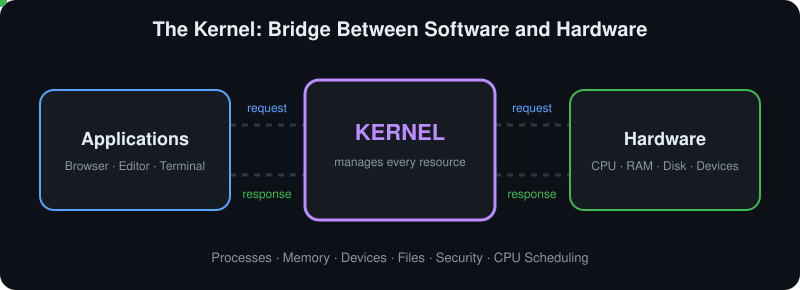
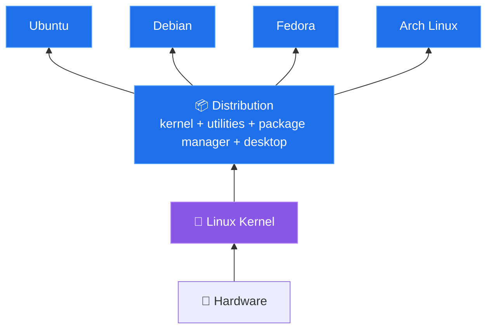
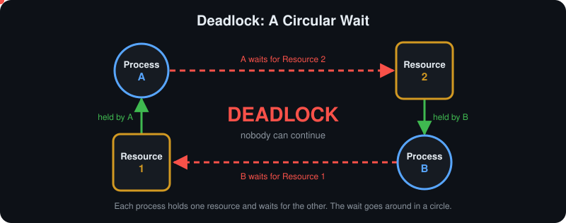
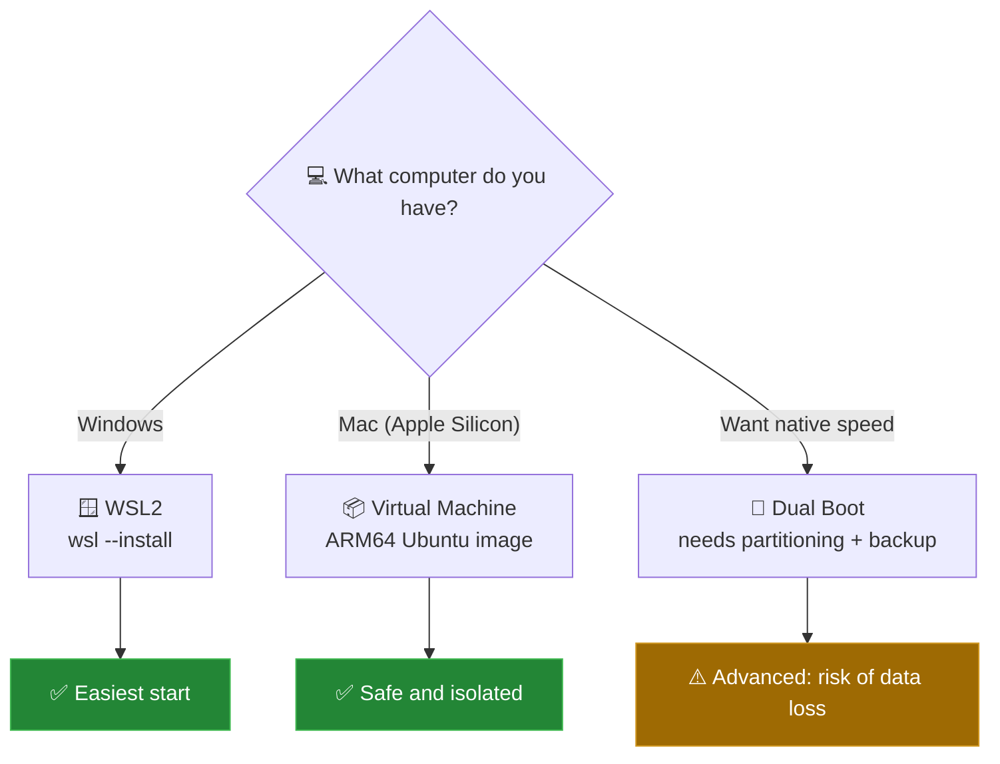
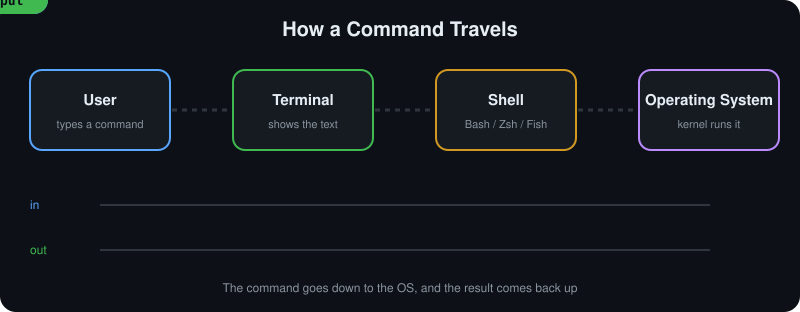
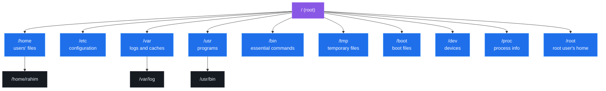
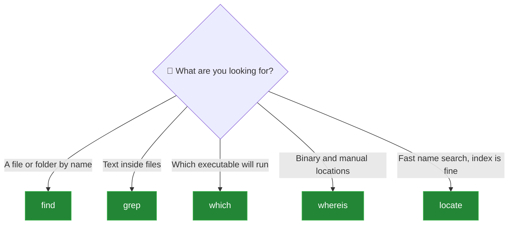

<div align="center">

# 🐧 Linux Learning Notes

### *A Beginner-to-Intermediate Journey into Linux Fundamentals and Command-Line Operations*


[-8a2be2?style=for-the-badge&logo=gitbook&logoColor=white)](./book_study_linu_part2.md)
[](https://www.linkedin.com/in/atia-sanjida-085947233/)

**What each command does · why it is used · how it works · when to use it**

</div>

---

> [!NOTE]
> A structured collection of Linux learning notes, command explanations, practical examples, and exercises. This repository documents my journey from operating system fundamentals to working with directories, files, permissions, and file-searching commands.

---

## 📚 Table of Contents

| # | Chapter | What You'll Find |
|:-:|---|---|
| 🛠️ | [Learning Environment](#learning-environment) | My setup: macOS + Ubuntu VM |
| 1 | [Introduction to Linux](#chapter-1-introduction-to-linux) | Kernel, distributions, OS comparison, deadlock |
| 2 | [Bringing Linux Home](#chapter-2-bringing-linux-home) | WSL2, virtual machines, dual boot, first commands |
| 3 | [Understanding the Language of Linux](#chapter-3-understanding-the-language-of-linux) | Terminal vs shell, prompt, command structure, help |
| 4 | [Exploring the Linux Filesystem](#chapter-4-exploring-the-linux-filesystem) | Directory layout, paths, navigation, permissions |
| 5 | [Managing Files and Directories](#chapter-5-managing-files-and-directories) | `mkdir` `touch` `cp` `mv` `rm`, wildcards |
| 6 | [Finding Lost Files](#chapter-6-finding-lost-files) | `find` `grep` `which` `whereis` `locate` |
| 📖 | [Part 2: Field Guide](./book_study_linu_part2.md) | Chapters 7–9: `apt`, text editors, redirection |
| ✍️ | [Practical Exercises](#practical-exercises) | Hands-on practice |
| ⚡ | [Command Cheat Sheet](#important-command-cheat-sheet) | Quick reference |
| 🧠 | [Things to Remember](#important-things-to-remember) | Key takeaways |
| 📈 | [Learning Progress](#learning-progress) | Where I am and what's next |

---

## 💻 Learning Environment

My primary computer is a **MacBook Air M4 with 16 GB RAM**.

I use macOS Terminal to practise common Unix commands and plan to use an Ubuntu virtual machine for Linux-specific administration and server-related tasks.

| Environment | Purpose |
|---|---|
| 🍎 macOS Terminal | Practising basic terminal commands |
| 🐧 Ubuntu Linux | Learning actual Linux administration |
| 📦 Virtual Machine | Running Linux separately from macOS |
| 🐙 GitHub | Storing and organizing learning notes |

> [!IMPORTANT]
> macOS is Unix-like, but it is **not** a Linux distribution. Many basic commands are similar, but some options, tools, and administrative commands differ.

<p align="right"><a href="#table-of-contents">⬆️ Back to Top</a></p>

---

<br>

# 🐧 Chapter 1: Introduction to Linux

> **🎯 In this chapter:** what Linux is, what a kernel does, how Linux compares with Windows and macOS, and what deadlock means.

## 1. What Is Linux?

Linux is an open-source operating system **kernel**.

It is widely used in:

- 🖥️ Servers
- 🚀 Supercomputers
- ☁️ Cloud infrastructure
- 🔌 Embedded systems
- 🌐 Networking devices
- 📱 Android-based devices

Linux is known for its flexibility, security features, stability, and open-source development model.

## 2. Understanding the Kernel

The **kernel** is the core component of an operating system. It acts as a bridge between software and computer hardware.

Applications cannot normally control hardware directly. They request services from the operating system, and the kernel manages the required resources.

### Main Responsibilities of the Kernel

| Responsibility | Explanation |
|---|---|
| ⚙️ Process Management | Creates, schedules, and manages running processes |
| 🧮 Memory Management | Allocates and manages RAM and virtual memory |
| 🔌 Device Management | Communicates with hardware through device drivers |
| 🗄️ File System Management | Handles file operations and filesystem access |
| 🔐 Security and Permissions | Enforces access controls |
| ⏱️ CPU Scheduling | Decides which process gets CPU time |

<p align="center">
  
  <br><sub><i>🎬 Animated: requests flow down to the hardware, responses flow back up</i></sub>
</p>

### Simple Example: Opening a Browser

1. The operating system receives the request to start the application.
2. The executable and required libraries are loaded.
3. The system creates a process and provides the necessary resources.
4. Virtual memory is assigned.
5. The scheduler provides CPU time.
6. The browser begins executing.

The kernel manages the underlying resources throughout this process.

## 3. Linux Kernel vs Linux Distribution

These two terms are related but not identical.

- **Linux Kernel:** the central component responsible for managing hardware and system resources.
- **Linux Distribution:** the Linux kernel combined with other software, system utilities, package-management tools, and often a desktop environment.

**Examples of distributions:** Ubuntu · Debian · Fedora · Arch Linux



| Linux Kernel | Linux Distribution |
|---|---|
| Core of the operating system | Complete operating-system package |
| Manages hardware and resources | Provides a usable operating environment |
| Not a complete desktop experience by itself | May include desktop environments and applications |
| Foundation of distributions | Built around the Linux kernel |

> [!TIP]
> **Remember:** Ubuntu is a Linux *distribution*, not simply another name for the Linux kernel.

## 4. Linux vs Windows vs macOS

All three operating systems manage hardware, memory, processes, files, and applications, but their internal architectures and ecosystems differ.

| Feature | 🐧 Linux | 🪟 Windows | 🍎 macOS |
|---|---|---|---|
| Kernel architecture | Modular monolithic | Hybrid NT architecture | Hybrid XNU architecture |
| Kernel | Linux | Windows NT | XNU |
| Source model | Open source | Proprietary | XNU source available; macOS largely proprietary |
| Executable format | ELF | PE | Mach-O |
| Common filesystems | ext4, XFS, Btrfs | NTFS, FAT32, exFAT | APFS, HFS+ |
| Common distributions/versions | Ubuntu, Fedora, Debian | Windows 10, Windows 11 | macOS releases |

### Kernel Architecture

- **Linux** uses a modular monolithic kernel.
- **Windows** uses the Windows NT hybrid architecture.
- **macOS** uses the XNU hybrid kernel, combining technologies from Mach and BSD, along with IOKit.

### Executable Formats

An executable format defines how an operating system recognizes and loads program files.

| Operating System | Common Executable Format |
|---|---|
| Linux | ELF |
| Windows | PE |
| macOS | Mach-O |

## 5. What Happens When You Open an Application?

A simplified process:

| Step | Stage | What Happens |
|:-:|---|---|
| 1 | **Launch request** | The user requests to open an application |
| 2 | **Executable loading** | The OS locates and loads the executable |
| 3 | **Library loading** | Required shared libraries or frameworks are made available |
| 4 | **Process creation** | The OS creates a process |
| 5 | **Memory allocation** | The process receives virtual memory |
| 6 | **Thread creation** | The application may create one or more execution threads |
| 7 | **CPU scheduling** | The scheduler provides CPU time |
| 8 | **Execution** | The application begins performing its tasks |

<p align="center">
  
  <br><sub><i>🎬 Animated: each step lights up in order</i></sub>
</p>

### Process Creation Differences

| OS | Common Mechanism |
|---|---|
| Linux | `fork()` and `execve()`, or `posix_spawn()` in some situations |
| Windows | `CreateProcess()` |
| macOS | `posix_spawn()` and application-launch services |

## 6. Understanding Deadlock

A **deadlock** is a situation in which two or more processes are permanently waiting for resources held by one another. As a result, none of them can continue.

### Example

<p align="center">
  
  <br><sub><i>🎬 Animated: the red dots show the circular wait that never ends</i></sub>
</p>


- Process A holds Resource 1 and waits for Resource 2.
- Process B holds Resource 2 and waits for Resource 1.

Neither can continue because each is waiting for the other.

### Four Necessary Conditions of Deadlock

> [!WARNING]
> All four conditions must exist **simultaneously** for a deadlock to occur.

| Condition | Explanation |
|---|---|
| 🔒 Mutual Exclusion | A resource can be used by only one process at a time |
| ✋ Hold and Wait | A process holds one resource while waiting for another |
| 🚫 No Preemption | Resources cannot be forcibly taken away |
| 🔄 Circular Wait | Processes form a circular chain of resource waiting |

### Ways to Prevent Deadlock

- ✅ Maintain a consistent order when acquiring locks.
- ✅ Avoid holding resources unnecessarily while waiting.
- ✅ Use timeouts where appropriate.
- ✅ Release resources properly.
- ✅ Design synchronization carefully.

Deadlock is possible in Linux, Windows, and macOS.

<p align="right"><a href="#table-of-contents">⬆️ Back to Top</a></p>

---

<br>

# 🏠 Chapter 2: Bringing Linux Home

> **🎯 In this chapter:** the different ways to run Linux, virtual machine basics, and your very first commands.

## 1. Ways to Use Linux

| Method | Best For | Difficulty |
|---|---|---|
| 🪟 **WSL2** | Windows users who want Linux inside Windows | ⭐ Easy |
| 📦 **Virtual Machine** | Running Linux safely alongside your main OS | ⭐⭐ Medium |
| 💽 **Dual Boot** | Native performance and hardware access | ⭐⭐⭐ Advanced |



### Method 1: WSL2

WSL stands for **Windows Subsystem for Linux**. WSL2 lets you run a Linux environment inside Windows without setting up a traditional dual-boot system.

**Basic installation process:**

1. Open PowerShell as Administrator.
2. Execute:

   ```powershell
   wsl --install
   ```

3. Restart the computer if required.
4. Open the installed Ubuntu distribution.
5. Create a Linux username and password.

> [!NOTE]
> While entering a Linux password in the terminal, the characters usually **do not appear** on the screen. This is normal.

WSL2 is specifically for Windows.

### Method 2: Virtual Machine

A virtual machine (VM) is a software-based computer that runs inside a physical computer. Virtualization software allows a computer to run another operating system independently.

*Example:* physical computer = macOS, virtual machine = Ubuntu Linux.

The book recommends approximately:

| Resource | Suggested Amount |
|---|---|
| Virtual machine RAM | 4 GB |
| Virtual disk | 25 GB |
| Physical host RAM | Ideally 8 GB or more |

*These are learning recommendations, not universal minimum requirements.*

#### Important VM Terms

| Term | Meaning |
|---|---|
| **ISO File** | A disk-image file commonly used to install an operating system |
| **Virtual Machine** | A software-based computer with virtual CPU, RAM, storage, and networking |
| **Virtual Disk** | A file on the physical computer that acts as the VM's storage drive |

> [!WARNING]
> **Apple Silicon:** For an Apple Silicon MacBook, use an ARM64/AArch64-compatible Linux image and virtualization software that supports Apple Silicon. Do not assume that an x86 Ubuntu image or every virtualization application will work on an M-series Mac.

### Method 3: Dual Boot

Dual boot means installing two operating systems on the same physical computer. At startup, the user chooses which operating system to run (for example, Windows or Linux).

| ✅ Advantages | ❌ Disadvantages |
|---|---|
| Both OSes run directly on the hardware | Requires disk partitioning |
| Useful when you need native OS access | Installation mistakes can cause data loss |
| | Requires careful backup and configuration |

> [!CAUTION]
> Dual boot is **not** the recommended starting method for beginners.

## 2. Using Linux Concepts on macOS

macOS has a Unix-like command-line environment, and many basic commands are similar to Linux commands:

```bash
pwd   ls   cd   mkdir   touch   cp   mv   rm   find   grep
```

However, macOS uses its own system components and command implementations:

- macOS Terminal normally opens **Zsh** by default.
- Linux distributions commonly use **Bash**, although other shells are available.
- Some GNU/Linux command options are not available in macOS versions.

> [!TIP]
> **Learning strategy:** Practise common commands on macOS first, then use Ubuntu for Linux-specific administration.

## 3. First Commands

### `echo`

**Purpose:** Displays text or the value of a shell variable.

```bash
echo [OPTION] [STRING]
```

```bash
echo "Hello Linux"
```

```text
Hello Linux
```

### `$USER`

`$USER` is a shell variable that commonly stores the current username.

```bash
echo $USER
```

> [!NOTE]
> `$USER` is a **variable**, not a command.

<p align="right"><a href="#table-of-contents">⬆️ Back to Top</a></p>

---

<br>

# 💬 Chapter 3: Understanding the Language of Linux

> **🎯 In this chapter:** the difference between terminal, shell, and Bash; how to read a prompt; how commands are structured; and how to get help.

## 1. Terminal vs Shell vs Bash

| Term | What It Is | Examples |
|---|---|---|
| **Terminal** | An application where users enter commands and view output | macOS Terminal, GNOME Terminal, Konsole |
| **Shell** | A command interpreter that receives commands and asks the OS to perform them | Bash, Zsh, Fish |
| **Bash** | *Bourne Again Shell*, a widely used Unix shell | Supports commands, variables, history, loops, conditions, scripting, automation |

### Relationship

<p align="center">
  
  <br><sub><i>🎬 Animated: a command goes down, the output comes back up</i></sub>
</p>


> [!IMPORTANT]
> macOS Terminal normally uses **Zsh** by default, not Bash.

## 2. Understanding the Linux Prompt

```bash
rahim@laptop:~$
```

| Part | Meaning |
|---|---|
| `rahim` | Username |
| `@` | Separates username and hostname |
| `laptop` | Hostname |
| `~` | Current user's home directory |
| `$` | Normal-user prompt |

### `$` vs `#`

- `$` usually indicates a **normal user** shell.
- `#` usually indicates a **root** shell.

> [!TIP]
> Do **not** type the `$` or `#` prompt symbol when copying a command from a tutorial.

## 3. Command Structure

```bash
command -option argument
```

| Component | Purpose |
|---|---|
| Command | Performs an action |
| Option | Changes how the command works |
| Argument | Specifies the target or input |

**Example:**

```bash
ls -l /home
```

| Piece | Role |
|---|---|
| `ls` | command |
| `-l` | option |
| `/home` | argument |

### Common `ls` Options

| Command | What It Does |
|---|---|
| `ls` | Lists directory contents |
| `ls -l` | Displays detailed information |
| `ls -a` | Displays hidden files and directories |
| `ls -la` | Combines long-format and hidden-file listings |

## 4. Linux Is Case-Sensitive

Linux filenames and command names are case-sensitive.

```bash
ls     # ✅ works
LS     # ❌ different (and unknown) command
```

These are three **different** filenames on a case-sensitive filesystem:

```text
Hello.txt
hello.txt
HELLO.txt
```

## 5. Understanding Spaces

Spaces separate commands, options, and arguments.

```bash
ls -l     # ✅ Correct
ls-l      # ❌ Incorrect: interpreted as a different command name
```

## 6. Getting Help

### Method 1: `--help`

Displays short help information for many GNU commands.

```bash
ls --help
```

### Method 2: `man`

Displays the manual page of a command.

```bash
man ls
```

| Key | Action |
|---|---|
| ⬆️ Up Arrow | Move upward |
| ⬇️ Down Arrow | Move downward |
| `Space` | Next page |
| `q` | Quit the manual |

> [!NOTE]
> **macOS:** Many macOS commands use BSD versions rather than GNU versions, so `ls --help` may not work. Use `man ls` for detailed documentation.

## 7. Basic Commands

| Command | Purpose |
|---|---|
| `date` | Displays the current date and time |
| `whoami` | Displays the effective username of the current user |

### `$USER` vs `whoami`

| `$USER` | `whoami` |
|---|---|
| Shell variable | Command |
| Displays the value stored in the variable | Reports the effective user identity |
| Can depend on shell environment | Reports the identity used by the running process |

They often display the same username, but they are not guaranteed to match in every situation.

<p align="right"><a href="#table-of-contents">⬆️ Back to Top</a></p>

---

<br>

# 🌳 Chapter 4: Exploring the Linux Filesystem

> **🎯 In this chapter:** how Linux organizes everything under `/`, how to navigate it, and how permissions control access.

## 1. Understanding the Linux Filesystem

Linux uses a hierarchical filesystem that starts from a single root directory:

```text
/
```

Everything in the Linux directory structure exists under this root. Unlike Windows, which commonly uses drive letters such as `C:` and `D:`, Linux organizes everything under `/`.

### 🌳 The Tree at a Glance



## 2. Important Linux Directories

### Main Directories

| Directory | Purpose |
|---|---|
| `/` | Root of the entire filesystem |
| `/home` | Home directories of normal users |
| `/root` | Home directory of the root user |
| `/etc` | System configuration files |
| `/var` | Variable data, logs, caches, and application data |
| `/usr` | Many installed programs and supporting files |
| `/bin` | Essential user commands; often merged into `/usr/bin` on modern distributions |
| `/tmp` | Temporary files |

### Additional Important Directories

| Directory | Purpose |
|---|---|
| `/boot` | Files required for booting the system |
| `/dev` | Device files representing hardware and virtual devices |
| `/proc` | Virtual filesystem providing process and kernel information |
| `/sys` | Virtual filesystem exposing device and kernel information |
| `/opt` | Optional application software |
| `/mnt` | Common temporary mount point |
| `/media` | Common mount point for removable media |
| `/srv` | Data served by system services |

### Examples of Files Inside Directories

<details>
<summary><b>📁 <code>/etc</code></b>: system configuration</summary>

```text
/etc/passwd
/etc/group
/etc/hostname
/etc/hosts
/etc/fstab
/etc/ssh/
/etc/apt/
```

</details>

<details>
<summary><b>📁 <code>/var</code></b>: changing system and application data</summary>

```text
/var/log/
/var/cache/
/var/lib/
/var/mail/
/var/spool/
/var/tmp/
```

</details>

<details>
<summary><b>📁 <code>/usr</code></b>: installed programs and resources</summary>

```text
/usr/bin/
/usr/sbin/
/usr/lib/
/usr/local/
/usr/share/
/usr/include/
```

</details>

<details>
<summary><b>📁 <code>/boot</code></b>: boot-related files</summary>

Examples may include:

```text
vmlinuz
initrd.img
grub/
```

</details>

<details>
<summary><b>📁 <code>/dev</code></b>: device files</summary>

```text
/dev/null
/dev/zero
/dev/random
/dev/tty
/dev/sda
```

The exact devices depend on the machine.

</details>

<details>
<summary><b>📁 <code>/proc</code></b>: virtual process and kernel information</summary>

```text
/proc/cpuinfo
/proc/meminfo
/proc/version
```

It also contains directories named after process IDs.

</details>

<details>
<summary><b>📁 <code>/sys</code></b>: devices, drivers, and kernel interfaces</summary>

Provides information about devices, drivers, and kernel interfaces through a virtual filesystem.

</details>

> [!IMPORTANT]
> **macOS difference:** Linux stores normal users' home directories under `/home/username`, while macOS normally uses `/Users/username`.

## 3. Absolute vs Relative Paths

| | Absolute Path | Relative Path |
|---|---|---|
| **Starts from** | `/` (filesystem root) | The current directory |
| **Depends on current location?** | No | Yes |
| **Example** | `/home/rahim/projects` | `projects` |

An absolute path identifies a location independently of the current directory. A relative path's meaning depends on where you currently are.

## 4. Navigation Commands

### `pwd`: Print Working Directory

```bash
pwd
```

Displays the current directory.

### `cd`: Change Directory

| Command | What It Does |
|---|---|
| `cd /tmp` | Moves to `/tmp` |
| `cd ~` | Moves to the current user's home directory |
| `cd` | Also moves to the home directory |
| `cd ..` | Moves one directory level upward |
| `cd -` | Returns to the previous working directory |

### Understanding `~`

The tilde (`~`) represents the current user's home directory.

```bash
cd ~/Documents
```

Moves to the `Documents` directory inside the current user's home directory, if it exists.

### Tab Completion

Pressing the <kbd>Tab</kbd> key helps complete filenames and directory names.

```bash
cd Doc    # press Tab to complete
```

If multiple matches exist, pressing <kbd>Tab</kbd> again may display the available options.

## 5. Understanding File Permissions

Linux uses permissions to control who can access files and directories.

### Who Can Have Permissions?

| Category | Symbol | Meaning |
|---|:-:|---|
| User | `u` | Owner of the file |
| Group | `g` | Users belonging to the file's group |
| Others | `o` | All other users |
| All | `a` | User, group, and others |

### The Three Basic Permissions

| Permission | Symbol | Numeric Value |
|---|:-:|:-:|
| Read | `r` | **4** |
| Write | `w` | **2** |
| Execute | `x` | **1** |

### Meaning for Files

| Permission | Meaning |
|---|---|
| Read (`r`) | Read the file's contents |
| Write (`w`) | Modify the file's contents |
| Execute (`x`) | Run the file as a program or script, subject to other requirements |

### Meaning for Directories

Directory permissions work differently.

| Permission | Meaning |
|---|---|
| Read (`r`) | List directory entries, subject to other permissions |
| Write (`w`) | Create, delete, or rename entries, subject to other restrictions |
| Execute (`x`) | Traverse or access the directory |

> [!IMPORTANT]
> Deleting a file generally depends on **write and execute permissions on its parent directory**, not simply on the file's own write permission. You also need execute permission on the relevant parent directories in a path to access something inside them.

## 6. Reading Permission Output

```bash
ls -l
```

```text
-rw-r--r-- 1 rahim developers 1200 Jul 12 10:30 notes.txt
```

Understanding the first part, `-rw-r--r--`:

```text
 -   rw-   r--   r--
 │    │     │     │
 │    │     │     └── Others permissions
 │    │     └──────── Group permissions
 │    └────────────── Owner permissions
 └─────────────────── File type
```

The first character indicates the file type:

| Symbol | Meaning |
|:-:|---|
| `-` | Regular file |
| `d` | Directory |
| `l` | Symbolic link |

### Useful Inspection Commands

| Command | What It Shows |
|---|---|
| `ls -l` | Detailed information about directory contents |
| `ls -ld /etc` | Information about the `/etc` directory itself |
| `ls -l /etc/passwd` | Information about the specified file |
| `ls -la` | Detailed information, including hidden entries |

## 7. Changing Permissions and Ownership

### `chmod`: Change Mode

Changes file or directory permissions.

#### Symbolic Method

| Command | Effect |
|---|---|
| `chmod g+w file.txt` | Adds write permission for the group |
| `chmod o-r file.txt` | Removes read permission from others |
| `chmod a+r file.txt` | Adds read permission for everyone |
| `chmod +x script.sh` | Adds execute permission according to the command's default target classes |

#### Numeric Method

Add the values (Read = 4, Write = 2, Execute = 1) to calculate each permission group.

**Example: `chmod 755`**

```bash
chmod 755 script.sh
```

| Category | Calculation | Permission |
|---|---|:-:|
| Owner | 4 + 2 + 1 = **7** | `rwx` |
| Group | 4 + 0 + 1 = **5** | `r-x` |
| Others | 4 + 0 + 1 = **5** | `r-x` |

Final permission: `rwxr-xr-x`

**Example: `chmod 644`**

```bash
chmod 644 notes.txt
```

| Category | Calculation | Permission |
|---|---|:-:|
| Owner | 4 + 2 = **6** | `rw-` |
| Group | 4 = **4** | `r--` |
| Others | 4 = **4** | `r--` |

Final permission: `rw-r--r--`

> [!CAUTION]
> Avoid using `chmod 777` without a specific reason. It gives **everyone** read, write, and execute permissions.

### `chown`: Change Owner

```bash
chown user file.txt              # changes the owner
sudo chown user:group file.txt   # changes the owner and group
```

### `sudo`

`sudo` allows an authorized user to execute a command with elevated privileges.

```bash
sudo command
```

> [!WARNING]
> Use elevated privileges only when necessary. A command executed with `sudo` can make system-wide changes.

### User and Group Inspection

| Command | What It Shows |
|---|---|
| `whoami` | The effective username |
| `groups` | The groups associated with the current user |

On Linux, additional user and group information can be found in `/etc/passwd` and `/etc/group`.

<p align="right"><a href="#table-of-contents">⬆️ Back to Top</a></p>

---

<br>

# 📁 Chapter 5: Managing Files and Directories

> **🎯 In this chapter:** creating, copying, moving, renaming, and deleting files and directories.

## 1. `mkdir`: Create Directories

`mkdir` stands for **Make Directory**.

```bash
mkdir directory_name
```

| Task | Command | Result |
|---|---|---|
| Create one directory | `mkdir khelna` | `khelna/` |
| Create several | `mkdir khabar ghum` | `khabar/` and `ghum/` |
| Create nested directories | `mkdir -p khelna/bol/lal` | The complete structure |

The `-p` option means **parents**: it automatically creates missing parent directories. More explanation is in [section 8](#8-understanding-the--p-option-in-mkdir) below.

## 2. `touch`: Create Files

`touch` creates an empty file if it does not already exist.

```bash
touch note.txt                         # one file
touch file1.txt file2.txt file3.txt    # several files
```

> [!NOTE]
> If a file already exists, `touch` normally updates its modification timestamp rather than deleting or replacing its contents.

## 3. `cp`: Copy Files and Directories

`cp` means **Copy**.

```bash
cp source destination
```

| Task | Command |
|---|---|
| Copy a file | `cp note.txt note-backup.txt` |
| Copy a file into a directory | `cp note.txt khelna/` |
| Copy a directory | `cp -r khelna khelna2` |

The `-r` option means **recursive** copying. It allows the command to copy a directory and its contents. Without it, copying a directory normally produces an error.

## 4. `mv`: Move and Rename

`mv` means **Move**. It can move files and directories or rename them.

| Task | Command |
|---|---|
| Move a file | `mv note-backup.txt ghum/` |
| Rename a file | `mv note.txt diary.txt` |
| Move and rename together | `mv diary.txt ghum/new-diary.txt` |

## 5. `rm`: Remove Files and Directories

`rm` means **Remove**.

| Task | Command |
|---|---|
| Delete a file | `rm diary.txt` |
| Delete a directory and its contents | `rm -r khelna2` |
| Force removal | `rm -f file.txt` |
| Recursive force removal | `rm -rf folder` |

> [!CAUTION]
> - `rm` normally does **not** move files to a Recycle Bin.
> - Deleted files may be difficult or impossible to recover.
> - Always check the path before running removal commands.
> - Never experiment with dangerous removal commands on important system directories.

## 6. Hidden Files

In Unix-like systems, filenames beginning with a dot (`.`) are normally treated as hidden.

```text
.bashrc
.profile
```

List hidden files with:

```bash
ls -a
```

### Shell Configuration Files

`.bashrc` is commonly used to store Bash configuration, such as aliases, shell variables, custom settings, and command-related configuration.

> [!NOTE]
> macOS normally uses Zsh by default, so its common interactive shell configuration file is `.zshrc`.

## 7. Wildcards

Wildcards allow commands to match multiple filenames.

| Wildcard | Matches | Example |
|:-:|---|---|
| `*` | Zero or more characters | `ls note*` |
| `?` | Exactly one character | `ls note?.txt` |

```bash
ls note*              # filenames beginning with "note"
mv *.jpg chobi/       # moves all .jpg files into chobi/
```

`ls note?.txt` can match `note1.txt`, `note2.txt`, `noteA.txt`, but **not** `note10.txt`, because `?` represents exactly one character.

> [!TIP]
> **Safety tip:** Before using a wildcard with `rm`, inspect the matching files first with `ls *.txt`, then decide whether deletion is appropriate.

## 8. Understanding the `-p` Option in `mkdir`

The `-p` option means **parents**. It creates missing parent directories automatically.

<p align="center">
  
  <br><sub><i>🎬 Animated: parents are created one level at a time</i></sub>
</p>

**Without `-p`**, this fails if `animals` and `cats` do not exist:

```bash
mkdir animals/cats/persian
```

You would need to create them one by one:

```bash
mkdir animals
mkdir animals/cats
mkdir animals/cats/persian
```

**With `-p`**, one command creates everything:

```bash
mkdir -p animals/cats/persian
```

```text
animals/
└── cats/
    └── persian/
```

Another important behaviour: if the directory already exists, `mkdir -p animals` does not report an error.

| Command | Behaviour |
|---|---|
| `mkdir folder` | Creates one directory |
| `mkdir -p a/b/c` | Creates missing parent directories |
| `mkdir -p folder` | Does not complain if the directory already exists |

> [!TIP]
> Use `mkdir -p` whenever you want to create nested directories in one command or safely ensure a directory exists.

<p align="right"><a href="#table-of-contents">⬆️ Back to Top</a></p>

---

<br>

# 🔍 Chapter 6: Finding Lost Files

> **🎯 In this chapter:** five commands for locating files, searching inside files, and finding program locations.

| # | Command | One-Line Job |
|:-:|---|---|
| 1 | `find` | Search for files and directories |
| 2 | `grep` | Search for text *inside* files |
| 3 | `which` | Find which executable a command will run |
| 4 | `whereis` | Find a program's related files |
| 5 | `locate` | Fast filename search using an index |

## 1. `find`: Search for Files and Directories

**Purpose:** Searches for files and directories inside a specified location.

```bash
find location -name "filename"
```

### Practical Setup

```bash
cd ~

mkdir -p bari/ghor1 bari/ghor2/khat-er-niche

touch bari/ghor1/linu-r-bol.txt

touch bari/ghor2/khat-er-niche/linu.txt

touch bari/mach.jpg
```

This creates:

```text
bari/
├── ghor1/
│   └── linu-r-bol.txt
├── ghor2/
│   └── khat-er-niche/
│       └── linu.txt
└── mach.jpg
```

### Common `find` Searches

| Goal | Command |
|---|---|
| Find a specific file | `find bari -name "linu.txt"` |
| Names beginning with `linu` | `find bari -name "linu*"` |
| Files ending in `.jpg` | `find bari -name "*.jpg"` |
| Only directories | `find bari -type d` |
| Only regular files | `find bari -type f` |
| PDFs in your home directory | `find ~ -name "*.pdf"` |
| Case-insensitive search | `find bari -iname "LINU*"` |

Example output of `find bari -name "linu.txt"`:

```text
bari/ghor2/khat-er-niche/linu.txt
```

- `-type` specifies the type of item: `d` = directory, `f` = regular file.
- `-iname` ignores uppercase and lowercase differences, so it can match `linu.txt`, `LINU.txt`, and `Linu.txt`.

### Searching the Entire Filesystem

```bash
find / -name "something"
```

This starts searching from the root directory. You may see:

```text
Permission denied
```

This happens when your normal user does not have permission to access certain locations. It is a permission issue, not necessarily a command error. If you need access, try:

```bash
sudo find / -name "something"
```

`sudo` runs the command with root access (password protected).

> [!TIP]
> Start with a specific directory when practising, because searching the entire filesystem can take longer.

## 2. `grep`: Search Inside Files

**Purpose:** Searches for specific words or text inside files.

> [!NOTE]
> **`find` vs `grep`:** `find` searches for files and directories. `grep` searches for text *inside* files.

### Practical Example

Create a diary:

```bash
cd ~

echo "linu ke tika dite hobe 15 tarikh" > diary.txt

echo "aj linu saradin ghumiyeche" >> diary.txt

echo "linu r khabar sesh, kinte hobe" >> diary.txt
```

*The meanings of `>` and `>>` will be studied in Chapter 9.*

Now search for `tika`:

```bash
grep "tika" diary.txt
```

```text
linu ke tika dite hobe 15 tarikh
```

`grep` displays the matching line rather than printing the entire file.

### Useful `grep` Options

| Option | Meaning | Example |
|:-:|---|---|
| `-i` | Ignore case | `grep -i "LINU" diary.txt` |
| `-n` | Display line numbers | `grep -n "linu" diary.txt` |
| `-r` | Recursive search | `grep -r "tika" ~/bari` |
| `-c` | Count matching lines | `grep -c "linu" diary.txt` |

Example output of `grep -n "linu" diary.txt`:

```text
1:linu ke tika dite hobe 15 tarikh
2:aj linu saradin ghumiyeche
3:linu r khabar sesh, kinte hobe
```

`-r` searches through files inside a directory and its subdirectories.

#### Combine Options

```bash
grep -rn "password" project/
```

Searches recursively and displays matching line numbers, which is useful in a large programming project containing many files.

## 3. `which`: Find a Command Location

**Purpose:** Finds the executable selected through the shell's command search path.

```bash
which ls
```

```text
/usr/bin/ls
```

Other examples:

```bash
which grep
which python3
which git
```

Use `which` when you want to know **which executable your shell will run** for a command.

## 4. `whereis`: Find Program-Related Files

**Purpose:** Searches for a program and related files, such as executable and manual locations.

```bash
whereis ls
```

### `which` vs `whereis`

| `which` | `whereis` |
|---|---|
| Finds the executable selected through the command search path | Searches standard locations for program-related files |
| Useful for checking which command will run | Useful for locating binaries and manual files |

## 5. `locate`: Search Using an Index

**Purpose:** Searches for filenames using a previously created database or index.

### How It Works

- `find` searches directories **directly**.
- `locate` searches a **stored index** of filenames and their locations.

Therefore, `locate` is generally faster for large filename searches. However, the index may be outdated, and a recently created file may not appear until the index is updated.

### Installing `plocate` on Ubuntu/Debian

```bash
sudo apt install plocate
```

Search for a file:

```bash
locate diary.txt
```

> [!NOTE]
> **Platform note:** The `apt` installation command is for Ubuntu/Debian-based Linux distributions. It is not a standard macOS Terminal command.

## 6. Which Command Should You Use?

| Requirement | Command |
|---|---|
| Find a file by name | `find` |
| Find a directory | `find -type d` |
| Find regular files | `find -type f` |
| Find text inside files | `grep` |
| Find a command's executable | `which` |
| Find program-related files | `whereis` |
| Quickly search using a filename index | `locate` |



### 🧩 Easy Memory Technique

```text
File name             → find
Text inside a file    → grep
Command location      → which
Program-related files → whereis
Indexed file search   → locate
```

<p align="right"><a href="#table-of-contents">⬆️ Back to Top</a></p>

---

<br>

# 🧪 Practical Exercises

These exercises combine the commands studied so far.

## Exercise 1: Create a Directory Structure

**Step 1:** Set up the directories.

```bash
cd ~

mkdir -p songsar
cd songsar

mkdir khelna chobi
```

**Step 2:** Create files and check them.

```bash
touch bol1.txt bol2.txt bol3.txt mach1.jpg mach2.jpg dori.txt

ls
```

**Step 3:** Move the image files.

```bash
ls *.jpg
mv *.jpg chobi/
```

**Step 4:** Move files beginning with `bol`.

```bash
mv bol* khelna/
```

**Step 5:** Rename a file, then move it.

```bash
mv dori.txt rossi.txt
mv rossi.txt khelna/
```

**Step 6:** View the complete directory structure.

```bash
ls -R
```

**Step 7:** Return home and clean up when you no longer need the practice directory.

```bash
cd ~
rm -r songsar
```

## Exercise 2: Search for Files

Create the practice structure:

```bash
cd ~

mkdir -p golokdhadha/ghor{1,2,3}/tak

touch golokdhadha/ghor1/purono-note.txt

touch golokdhadha/ghor2/tak/dorkari-file.txt

touch golokdhadha/ghor3/chobi.jpg

touch golokdhadha/ghor3/tak/aro-chobi.jpg

echo "linu r janmodin 12 December" > golokdhadha/ghor2/tak/dorkari-file.txt
```

Now complete the following tasks:

| Task | Goal | Solution |
|:-:|---|---|
| 1 | Find `dorkari-file.txt` | `find golokdhadha -name "dorkari-file.txt"` |
| 2 | Find all JPG files | `find golokdhadha -name "*.jpg"` |
| 3 | Find all directories | `find golokdhadha -type d` |
| 4 | Search for `janmodin` | `grep -rn "janmodin" golokdhadha` |
| 5 | Find the location of `grep` | `which grep` |

<p align="right"><a href="#table-of-contents">⬆️ Back to Top</a></p>

---

<br>

# ⚡ Important Command Cheat Sheet

A quick reference for all the important commands covered in Chapters 1–6.

### 🧭 Basics and Navigation

| Command | Purpose | Example |
|---|---|---|
| `echo` | Display text | `echo "Hello"` |
| `date` | Display date and time | `date` |
| `whoami` | Show effective username | `whoami` |
| `groups` | Display user groups | `groups` |
| `pwd` | Show current directory | `pwd` |
| `cd` | Change directory | `cd /tmp` |
| `man` | Open manual | `man ls` |
| `--help` | Display command help where supported | `ls --help` |

### 📋 Listing

| Command | Purpose | Example |
|---|---|---|
| `ls` | List directory contents | `ls` |
| `ls -l` | Detailed listing | `ls -l` |
| `ls -a` | Show hidden entries | `ls -a` |
| `ls -la` | Detailed listing including hidden entries | `ls -la` |
| `ls -r` | Reverse the sort order | `ls -r` |
| `ls -ltr` | Detailed listing, oldest first (newest last) | `ls -ltr` |

### 📁 Files and Directories

| Command | Purpose | Example |
|---|---|---|
| `mkdir` | Create directory | `mkdir folder` |
| `mkdir -p` | Create missing parent directories | `mkdir -p a/b/c` |
| `touch` | Create empty file or update timestamp | `touch file.txt` |
| `cp` | Copy files | `cp a.txt b.txt` |
| `cp -r` | Copy directories recursively | `cp -r folder backup` |
| `mv` | Move or rename | `mv a.txt b.txt` |
| `rm` | Remove files | `rm file.txt` |
| `rm -r` | Remove directories recursively | `rm -r folder` |

### 🔐 Permissions

| Command | Purpose | Example |
|---|---|---|
| `chmod` | Change permissions | `chmod 755 script.sh` |
| `chown` | Change ownership | `sudo chown user file.txt` |
| `sudo` | Execute with elevated privileges | `sudo command` |

### 🔍 Searching

| Command | Purpose | Example |
|---|---|---|
| `find` | Search by filename or type | `find . -name "*.txt"` |
| `grep` | Search inside files | `grep "word" file.txt` |
| `which` | Find command executable | `which ls` |
| `whereis` | Find program-related files | `whereis ls` |
| `locate` | Search indexed filenames | `locate file.txt` |

<p align="right"><a href="#table-of-contents">⬆️ Back to Top</a></p>

---

<br>

# 🧠 Important Things to Remember

<details open>
<summary><b>🐧 Linux basics</b></summary>

1. Linux is the kernel; Ubuntu, Fedora, and Debian are Linux distributions.
2. The kernel manages hardware resources and provides core operating-system services.
3. Terminal, Shell, and Bash are different concepts.
4. macOS Terminal normally uses Zsh by default.
5. Linux commands and filenames are case-sensitive.

</details>

<details open>
<summary><b>🌳 Filesystem and permissions</b></summary>

6. The Linux filesystem starts from `/`.
7. `/root` is the root user's home directory, while `/` is the filesystem root.
8. Absolute paths start with `/`; relative paths depend on the current directory.
9. `pwd` displays the current directory.
10. `cd ..` moves to the parent directory.
11. `~` represents the current user's home directory.
12. `r`, `w`, and `x` represent read, write, and execute permissions.
13. File and directory permissions have different practical meanings.
14. `chmod` changes permissions, while `chown` changes ownership.

</details>

<details open>
<summary><b>📁 Managing files</b></summary>

15. `mkdir -p` creates missing parent directories automatically.
16. `touch` creates an empty file if it does not exist.
17. `cp -r` is used to copy directories recursively.
18. `mv` can both move and rename files.
19. `rm -r` removes directories and their contents.
20. Filenames beginning with `.` are normally hidden.
21. `*` matches zero or more characters; `?` matches exactly one character.

</details>

<details open>
<summary><b>🔍 Finding things</b></summary>

22. `find` searches for files and directories.
23. `grep` searches for text inside files.
24. `which` finds the executable selected through the command search path.
25. `whereis` searches for program-related files.
26. `locate` uses an index and may return outdated results.
27. `sudo` provides elevated privileges and must be used carefully.

</details>

<p align="right"><a href="#table-of-contents">⬆️ Back to Top</a></p>

---

<br>

# 📈 Learning Progress

```text
Chapters 1–6 complete   [██████████████████░░░]  6 / 7
```

| Chapter | Topic | Status |
|:-:|---|:-:|
| 01 | Introduction to Linux | ✅ Completed |
| 02 | Bringing Linux Home | ✅ Completed |
| 03 | Understanding the Language of Linux | ✅ Completed |
| 04 | Exploring the Linux Filesystem | ✅ Completed |
| 05 | Managing Files and Directories | ✅ Completed |
| 06 | Finding Lost Files | ✅ Completed |
| 07 | Installing Software with Package Managers | ➡️ [Available in Part 2](./book_study_linu_part2.md#-chapter-07--package-management-with-apt) |
| 08 | Reading & Editing Files | ➡️ [Available in Part 2](./book_study_linu_part2.md#-chapter-08--reading-and-editing-files) |
| 09 | Pipes & Redirection | ➡️ [Available in Part 2](./book_study_linu_part2.md#-chapter-09--pipes-and-redirection) |

---

<div align="center">

*Last updated: November 2026 · Repository: Linux Learning Notes · Coverage: Chapters 1–6*

<sub>Authored & maintained by <a href="https://github.com/AtiaAbk">Atia Sanjida (@AtiaAbk)</a> · <a href="https://www.linkedin.com/in/atia-sanjida-085947233/">LinkedIn</a></sub>

⭐ *Keep practising, one command at a time.* ⭐

</div>
